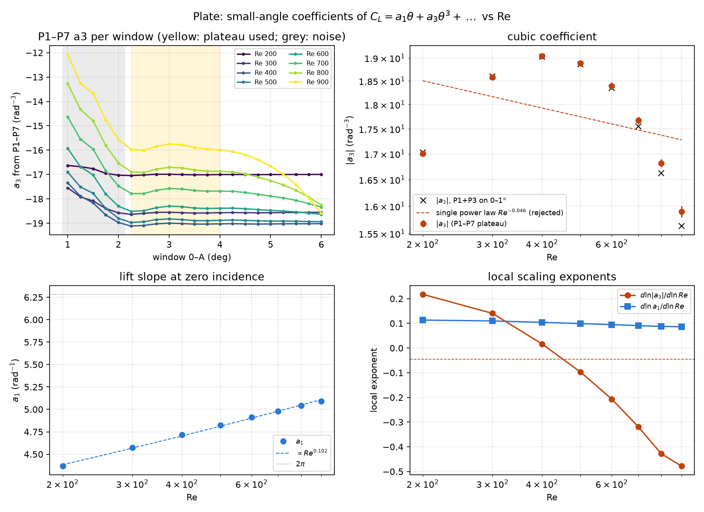

# Plate: how a1 and a3 depend on Re (Re = 200–900)

2026-10-10. This tests the second half of the claim in `static_airfoil/instructions/Quadratic_hypothesis.md`:
"a3 having a (local) scaling law with Re". It repeats the Re = 500 small-angle analysis
(`SMALL_ANGLE_LEGENDRE.md`) at every Re, with the same windows and fits.

- Plate geometry: thickness **t/c = 0.023** (2.3 % of chord); stadium section, semicircular edges of radius 0.0115c, overall length c = 1.
- Data: `re{200..900}/`, 0–6° at 0.25°. All 200 cases are converged on the force trace.
- Script: `a3_re_scaling.py`
- Outputs: `a3_re_scaling/` (`a3_vs_re.txt`, `a3_vs_re.csv`, `a3_vs_re.png`)

## Result

| Re | a1 (rad⁻¹) | a3 (rad⁻³), P1–P7 on 2.25–4° | a3, P1+P3 on 0–1° | local d ln\|a3\|/d ln Re |
|---:|---:|---:|---:|---:|
| 200 | 4.368 | −17.01 ± 0.02 | −17.03 | +0.22 |
| 300 | 4.573 | −18.58 ± 0.03 | −18.60 | +0.14 |
| 400 | 4.716 | −19.04 ± 0.04 | −19.03 | +0.02 |
| 500 | 4.825 | −18.89 ± 0.05 | −18.86 | −0.10 |
| 600 | 4.911 | −18.39 ± 0.07 | −18.35 | −0.21 |
| 700 | 4.982 | −17.67 ± 0.08 | −17.55 | −0.32 |
| 800 | 5.041 | −16.82 ± 0.08 | −16.62 | −0.43 |
| 900 | 5.093 | −15.90 ± 0.10 | −15.64 | −0.48 |

**The cubic exists at every Re.** a3 has a well-defined small-angle limit at each Reynolds number.
- The P1–P7 plateau varies by ±0.02–0.10.
- The independent two-term fit on 0–1° agrees with it: to within 0.05 up to Re 600, and to 1.6 %
  at Re 900.

**|a3| does not follow a power law in Re.** It is not even monotonic:
- |a3| rises from 17.0 (Re 200) to a maximum of about 19.05 near Re 400–450, then falls to 15.9
  by Re 900.
- A single power law fits badly: exponent −0.05 ± 0.05, with residuals up to 8 % in ln|a3|.
- ln|a3| is curved in ln Re (quadratic coefficient −0.26).
- A "local scaling law" therefore holds only in the sense of a local exponent, and that exponent
  drifts steadily from +0.22 to −0.48 over the range. Nothing here approaches a constant exponent.

**a1 does follow a clean power law:** a1 = 2.554 Re^0.102 (±0.002). Its local exponent falls only
slowly, from 0.113 to 0.086. a1 reaches 81 % of 2π at Re 900.

**a5 is negative at every Re.** Its size grows from about 110 (Re 200) to about 480 (Re 700–900).
It is poorly determined (±20 %).

## Why the plateau stops at 4°, not 6°

At Re = 500, the P1–P7 a3 is flat on windows 2.25–6°. At higher Re it is flat only up to about 4°,
and then drifts:
- At Re 900 it is −15.9 on 2.25–4°, −16.7 at 5° and −18.6 at 6°.
- On the largest windows, the log-slope of c3 rises from 3.1 (Re 200) to 4.6 (Re 900), against 3 for
  a smooth series.

The cause is that a **leading-edge bubble forms at lower angles as Re rises**. The test is the
upper-surface C_f (`lsb/plate_sweep.analyse`; cell centres written for those cases):

| Re | upper C_f,min at 5° | at 5.5° | at 6° | where the minimum is |
|---:|---:|---:|---:|---|
| 500 | 0.0194 | 0.0166 | 0.0137 | x ≈ 0.8 (aft) |
| 700 | 0.0141 | 0.0103 | 0.0057 | jumps to the LE (x ≈ 0.2) at 5.5° |
| 900 | 0.0077 | 0.0025 | **−0.0024** | LE; a closed bubble on x = 0.06–0.27 at 6° |

- Bubble formation: α_f ≈ 5.75° at Re 900, about 6.6° at Re 700 (extrapolated), and 7.9° at Re 500.
- Windows that run into this lead-up add content beyond θ⁷ that the fit can't hold, so they're left out.
- **The 2.25–4° plateau is used at every Re**, so all eight values are measured the same way. The
  Re = 500 value is unchanged (−18.89 against −18.90 from 2.25–6°).

## What this means for the hypothesis

- **"dC_L/dα is quadratic at small angles"** holds for the plate at every Re in 200–900. a3 is finite,
  nonzero and well measured.
- **"a3 has a (local) scaling law with Re"** fails as a power law.
  - a3(Re) has a maximum near Re ≈ 400–450.
  - Its local exponent changes sign, and still varies by 0.1 per step at the high end.
  - If "local" means a power law fitted over a narrow band, the exponent has to be quoted together
    with that band.
- The lift slope a1, by contrast, scales cleanly as Re^0.10.
- **Possible mechanism, not yet tested:** at low Re, viscous thickening dominates; at high Re, the
  approach to leading-edge separation, which moves toward α = 0 as Re rises, takes over. That would
  give the maximum.
- **Still to do:** the same analysis for NACA0006 (sweep running) and NACA0012
  (`steady_re_scaling`), to see whether the maximum is a plate feature or general.
