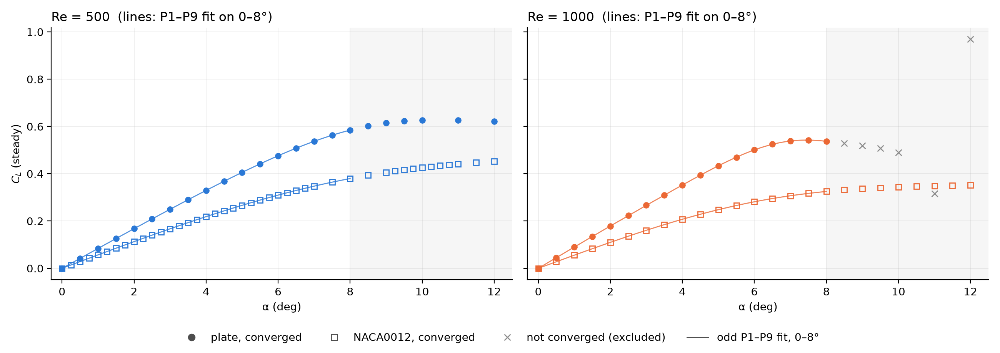
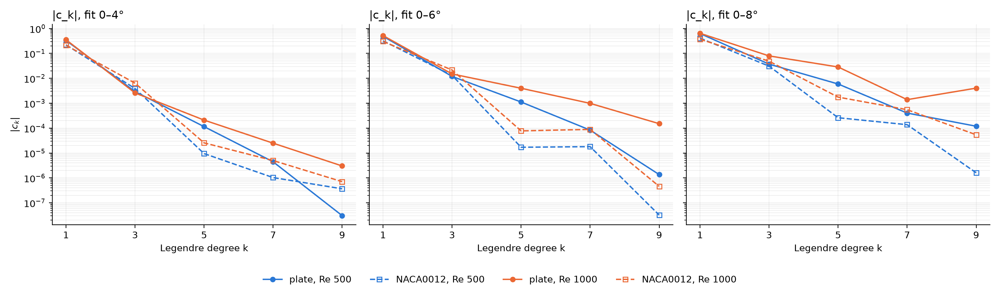

# Odd-Legendre fit of the plate lift curve, Re = 500 and 1000

Script: `analysis/legendre_plate.py` (research env). Outputs: `analysis/legendre/`.
Method identical to `static_airfoil/analysis/legendre_odd_fit.py`, and the NACA0012 is refitted
alongside with the same code, the same angle grid and the same windows.

## Summary

- **The plate is not "a cubic with different numbers".** On the NACA0012 the odd-Legendre
  coefficients fall by 1.5–3 decades from P3 to P5, so C_L ≈ a1θ + a3θ³ is complete below the
  knee. On the plate they fall by only 0.4–1.4 decades: c5/c3 is 4–36 % against
  < 4 % for the airfoil. The curvature is spread over P3, P5, P7.
- **As a consequence the plate's θ³ coefficient depends on the fit window; the airfoil's does
  not.** Collected two-term fits at Re = 500: plate a3 = −21.9 (0–4°), −26.7 (0–6°), −35.3
  (0–8°), a 61 % drift. NACA0012: −28.5, −28.7, −28.3.
- **The plate's linear slope is about 1.5× the airfoil's and rises with Re.** a1 = 4.83–4.91 per
  rad at Re = 500 and 5.14–5.50 at Re = 1000. The NACA0012 has 3.27 and 3.20, so its slope falls
  slightly with Re.
- **The plate's knee is much earlier.** C_L peaks at 10–11° (0.627) at Re = 500 and at 7.5°
  (0.542) at Re = 1000. At Re = 1000 the 0–8° window contains the peak, and the fit there is not
  usable: c9 > c7 and the residual is 3e-4.
- **There is no clean Re trend in the plate's c3.** Going from Re = 500 to 1000, |c3| falls 12 %
  on 0–4°, rises 25 % on 0–6° and doubles on 0–8°. The airfoil's |c3| rises by a consistent
  factor of 1.58–1.65 on all three windows (Re^0.70 from the 11-Re sweep in
  `static_airfoil/STEADY_LASSO_ReSweep.md`).





## Data

- **Plate:** `re500/` and `re1000/`. The value used is the last sample of the latest restart chunk
  of `postProcessing/forceCoeffs/<start>/forceCoeffs.dat`, with 13 significant digits rather than
  the 7 in `lift_coeffs.csv`. Only angles marked `CONVERGED` in `RESULTS.md` are used; that is the
  plate sweep's range-and-drift gate. The script asserts that no unconverged angle falls inside a
  window. At Re = 1000, 8.5° and above are unconverged, so 0–8° is the widest window at both Re.
- **NACA0012:** `static_airfoil/steady_re500/` and `steady_re1000/`, read through `collect()` with
  its force-trace verdict.
- **Grid:** 0.5°, so 9, 13 and 17 points on 0–4°, 0–6° and 0–8°, which become 17, 25 and 33 after
  mirroring. The condition number of the basis is 3.9, 2.9 and 2.7.

## Coefficients (x = θ/θ_max mirrored to [−1, 1], P1–P9, no intercept)

| shape | Re | window | c1 | c3 | c5 | c7 | c9 | \|c3/c1\| | \|c5/c3\| | RMSE |
|---|---:|---|---:|---:|---:|---:|---:|---:|---:|---:|
| plate | 500 | 0–4° | 0.3326 | −0.002937 | −1.15e-4 | −4.4e-6 | −3e-8 | 0.9 % | 3.9 % | 2.7e-7 |
| NACA0012 | 500 | 0–4° | 0.2226 | −0.003883 | −9.5e-6 | 1.0e-6 | 3.7e-7 | 1.7 % | 0.2 % | 2.4e-7 |
| plate | 1000 | 0–4° | 0.3551 | −0.002592 | −2.10e-4 | −2.5e-5 | −3.0e-6 | 0.7 % | 8.1 % | 5.3e-7 |
| NACA0012 | 1000 | 0–4° | 0.2139 | −0.006400 | −2.6e-5 | 5.0e-6 | 7.1e-7 | 3.0 % | 0.4 % | 5.4e-7 |
| plate | 500 | 0–6° | 0.4892 | −0.01196 | −1.12e-3 | −8.3e-5 | −1.4e-6 | 2.4 % | 9.4 % | 3.0e-7 |
| NACA0012 | 500 | 0–6° | 0.3229 | −0.01317 | −1.7e-5 | 1.8e-5 | 3e-8 | 4.1 % | 0.1 % | 2.2e-7 |
| plate | 1000 | 0–6° | 0.5212 | −0.01500 | −3.99e-3 | −9.9e-4 | −1.5e-4 | 2.9 % | 27 % | 1.1e-6 |
| NACA0012 | 1000 | 0–6° | 0.3028 | −0.02159 | 7.8e-5 | 8.9e-5 | −5e-7 | 7.1 % | 0.4 % | 5.7e-7 |
| plate | 500 | 0–8° | 0.6279 | −0.03719 | −5.92e-3 | −4.0e-4 | 1.2e-4 | 5.9 % | 16 % | 8.2e-6 |
| NACA0012 | 500 | 0–8° | 0.4102 | −0.03090 | 2.6e-4 | 1.4e-4 | −1.6e-6 | 7.5 % | 0.8 % | 5.0e-7 |
| plate | 1000 | 0–8° | 0.6428 | −0.07945 | −2.86e-2 | −1.4e-3 | 4.0e-3 | 12 % | 36 % | 3.0e-4 |
| NACA0012 | 1000 | 0–8° | 0.3716 | −0.04882 | 1.8e-3 | 5.5e-4 | −5.4e-5 | 13 % | 3.6 % | 2.8e-6 |

- **The plate's P5 is negative wherever it is significant.** It bends further in the same
  direction as P3, so the bend steepens faster than a cubic as the knee approaches. The airfoil's
  small P5 has either sign and is near the data floor below 8°.
- **The plate's c3 is less stable under truncation.** Dropping P5–P9 moves the plate's c3 by
  1.5–9 %: 1.5 % (Re 500, 0–4°), 3.3 % (Re 1000, 0–4°), 2.6 % and 9.0 % (0–6°), 3.3 % and 6.3 %
  (0–8°). The airfoil's moves by at most 0.94 %. Legendre orthogonality protects c3 from the higher
  terms only when those terms are small. On the plate they are not.

## Collected into θ: C_L = a1θ + a3θ³ (P1+P3 fit, θ in rad)

| shape | Re | 0–4° | 0–6° | 0–8° |
|---|---:|---|---|---|
| plate | 500 | 4.828θ − 21.9θ³ | 4.846θ − 26.7θ³ | 4.906θ − 35.3θ³ |
| NACA0012 | 500 | 3.271θ − 28.5θ³ | 3.272θ − 28.7θ³ | 3.269θ − 28.3θ³ |
| plate | 1000 | 5.144θ − 19.7θ³ | 5.206θ − 35.6θ³ | 5.496θ − 77.5θ³ |
| NACA0012 | 1000 | 3.201θ − 47.1θ³ | 3.200θ − 46.9θ³ | 3.183θ − 44.4θ³ |

Errors of the two-term fit, maximum absolute residual:

| shape | Re | 0–4° | 0–6° | 0–8° |
|---|---:|---:|---:|---:|
| plate | 500 | 5.9e-5 | 7.7e-4 | 4.5e-3 |
| NACA0012 | 500 | 4.9e-6 | 1.1e-5 | 2.8e-4 |
| plate | 1000 | 1.2e-4 | 3.2e-3 | 1.9e-2 |
| NACA0012 | 1000 | 1.3e-5 | 1.0e-4 | 1.6e-3 |

The 0–8° plate values at Re = 500 (4.906, −35.29) reproduce `re1000/analysis/RE_COMPARE.md`
exactly, which checks that the data loading agrees with the earlier analysis.

## What this means for "does the fit hold across shapes"

- **The form a1θ + a3θ³ fits the plate only in a narrow window.** On 0–4° it is within 6e-5 at
  Re = 500 and 1.2e-4 at Re = 1000. That is still 9–12× the airfoil's error on the same window.
- **The coefficients are not portable between shapes.** The plate's slope is about 1.5× the
  airfoil's, and its θ³ term is a window-dependent stand-in for a P3+P5+P7 bend.
- **A cross-shape model would need either the P5 term, or a saturating form.** For a saturating
  form, see `static_airfoil/bizarre_experiments/` (A·x/√(1+Bx²)). The plate's peak and fall at
  Re = 1000 suggests trying it here.

## Caveats

1. **The plate mesh is a single mesh per Re**, with no mesh study. The plate's sharp corners
   make it more exposed to this than the airfoil.
2. **"Converged" means different gates for the two shapes.** The plate's range-and-drift gate is
   ≤ 1e-5 relative; the airfoil uses its force-trace verdict. Both are below the fit residuals
   compared here.
3. **Only two Re are available for the plate,** so no Re scaling can be fitted.

## Reproduce

```bash
/home/raji/miniconda3/envs/research/bin/python plate_case/analysis/legendre_plate.py
```
