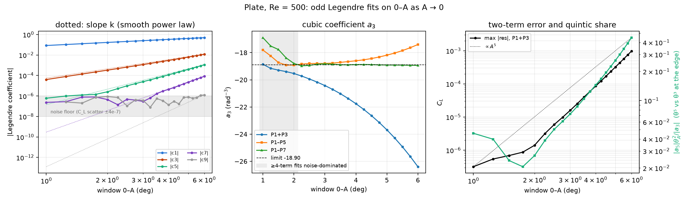

# Plate, Re = 500: does C_L → a1·θ + a3·θ³ at small angles?

2026-10-09. This is the FIRST step of `static_airfoil/instructions/Quadratic_hypothesis.md`. Each
window 0–A, for A = 1, 1.25, …, 6°, gets an odd Legendre fit. The data are every 0.25° point of
`re500/`, all converged. The question is whether the higher-order terms die out as A → 0 while
the cubic survives.

- Script: `legendre_small_angle.py`
- Outputs: `legendre_small_angle/` (`small_angle.txt`, `small_angle_windows.csv`, `small_angle.png`)

## Result: yes. The cubic survives, the higher terms vanish, and the limit is a3 = −18.90 ± 0.04 rad⁻³

**The cubic is genuine down to 1°.**
- A pure θ³ term puts a share proportional to A³ into c3. The measured c3 scales as A^3.06 over the
  four smallest windows.
- At A = 1° c3 is 4.0e-5, about 40× above the noise floor.

**The higher terms die faster than the cubic, as power-law terms should:**
- c5 falls as A^5.8 over 5–6°, and c7 as A^7.2.
- Below about 2.5° (c5) and 3.5° (c7) they hit the noise floor of about 1e-6 and flatten.
- c9 is at the floor everywhere: there is no measurable θ⁹ content on 0–6°.

**a3 has a finite, nonzero small-angle limit of −18.90 ± 0.04 rad⁻³.**
- The P1–P7 fit gives a3 between −18.85 and −18.94 on every window from 2.25° to 6°.
- The plain two-term fit on the smallest window, 0–1°, gives −18.86, where θ⁵ is below the noise.
- **The slope is a1 = 4.8246 rad⁻¹**, against 2π = 6.28 for a thin airfoil in inviscid flow.

**The two-term law, C_L = a1·θ + a3·θ³, holds well only for small angles:**

| window | θ⁵ term as a share of the θ³ term, at the window edge | max two-term error | a3 from the two-term fit |
|---|---:|---:|---:|
| 0–2° | ≈ 3 % (at the noise level) | 1.4e-6 | −19.5 |
| 0–3° | 7 % | 1.6e-5 | −20.4 |
| 0–4° | 14 % | 8.6e-5 | −21.8 |
| 0–5° | 26 % | 3.2e-4 | −23.7 |
| 0–6° | 45 % | 9.7e-4 | −26.4 |

- The θ⁵ term is negative, a5 ≈ −500 to −700 rad⁻⁵, so it adds to the bending.
- When only two terms are fitted, the θ⁵ term is pushed into a3, and **that is the only reason the
  two-term a3 depends on the window** (−18.9 → −26.4 over 0–1° → 0–6°).
- In terms of the slope: dC_L/dα is quadratic, a1 + 3a3θ², to within 7 % of its nonlinear part
  up to about 3°.
- By 6° the next term, 5a5θ⁴, is significant.

## Noise floor

- Fitted to a smooth curve, the steady C_L values scatter by **±4e-7**.
- This is the same for points computed with OpenFOAM-dev, OpenFOAM 13 and OpenFOAM v14. There is
  no offset between versions; it is each case's own convergence scatter.
- This scatter puts a floor of about 1e-6 under c5–c9.
- It makes four- and five-term fits on windows narrower than about 2.25° (n < 9 angles)
  unreliable. That is the grey band in the middle panel, where a3 from P1–P5 and P1–P7 drifts.

## What this means for the hypothesis

- For the plate, the small-angle form C_L = a1·θ + a3·θ³ is supported, with a well-defined
  a3(Re = 500) = −18.9 rad⁻³.
- The a3 that depends on the window (−26 to −35, in earlier notes and in
  `static_airfoil/lsb/HYPOTHESIS_TEST.md`) is the two-term fit soaking up θ⁵. It is not a
  different cubic.
- Any scaling law with Re should therefore be built on the small-angle limit, for example the
  P1–P7 value on a fixed window. A two-term fit on a fixed 0–6° window would mix in a5θ², which
  could carry its own Re dependence.
