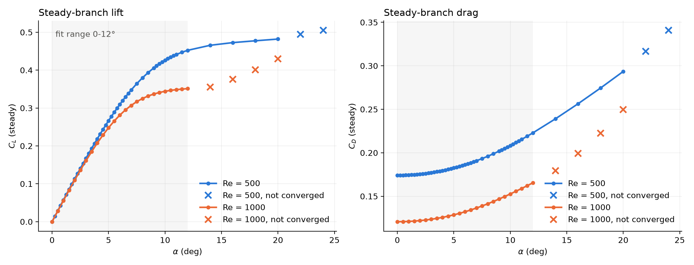
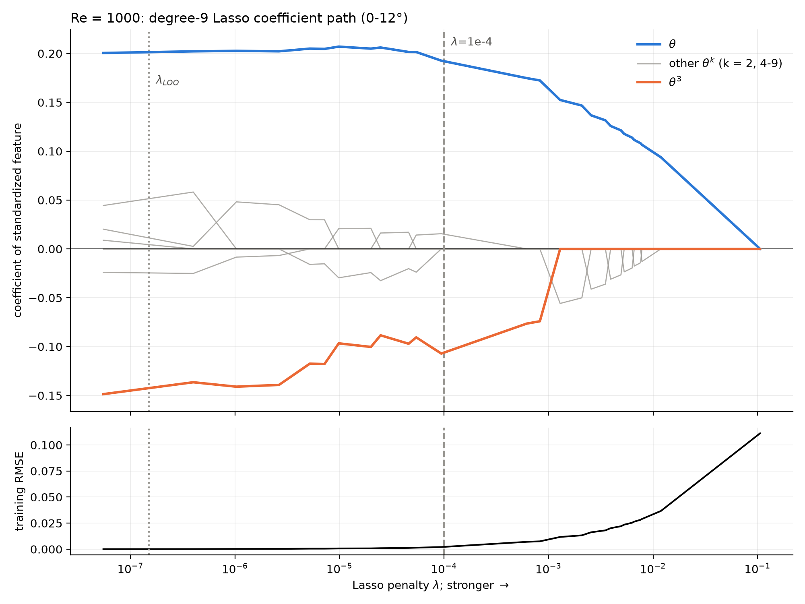
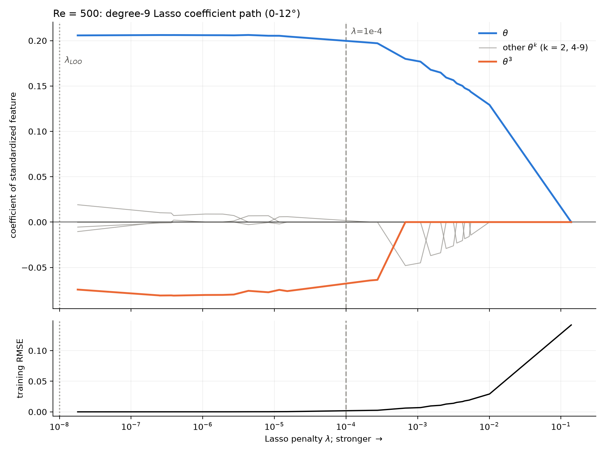
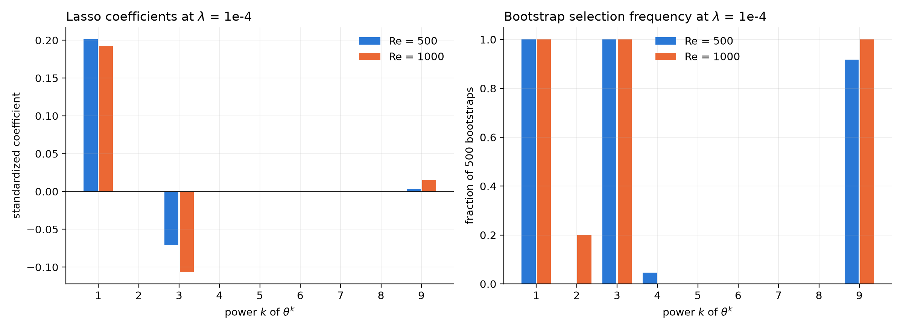
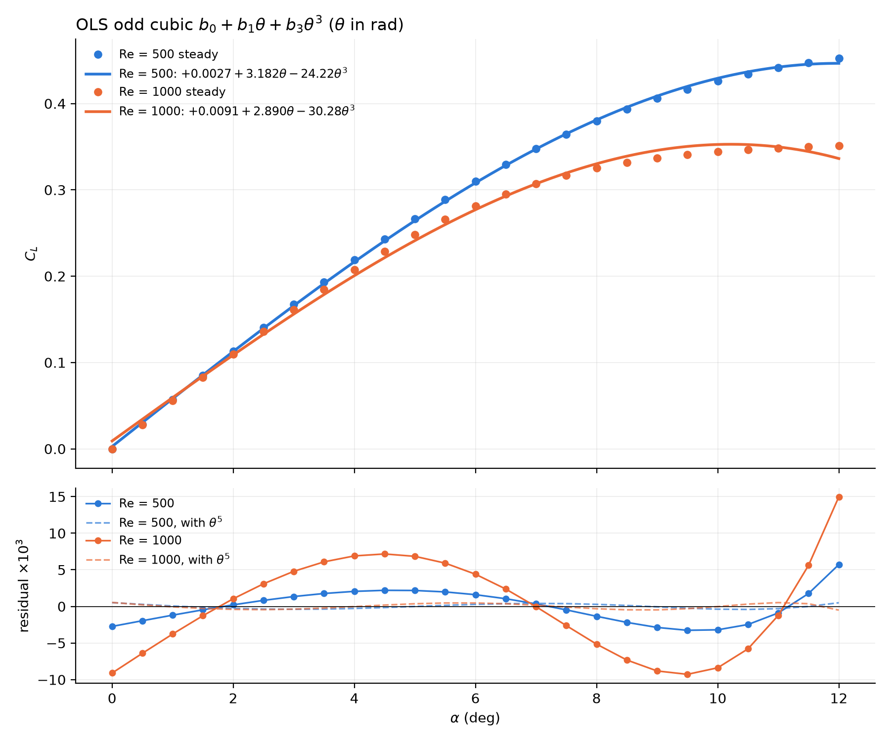
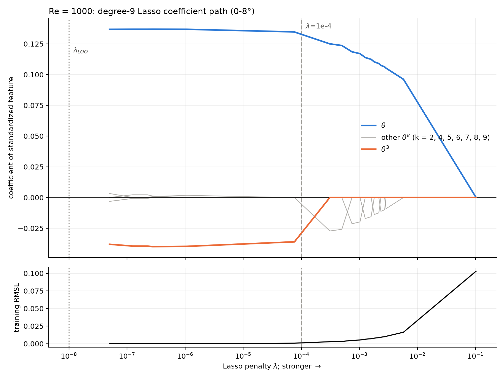
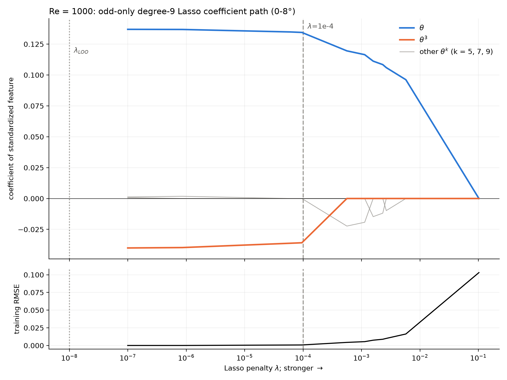
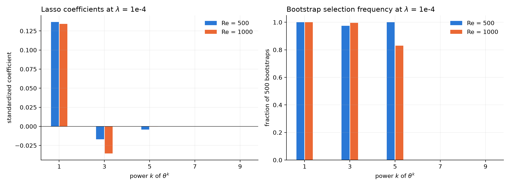
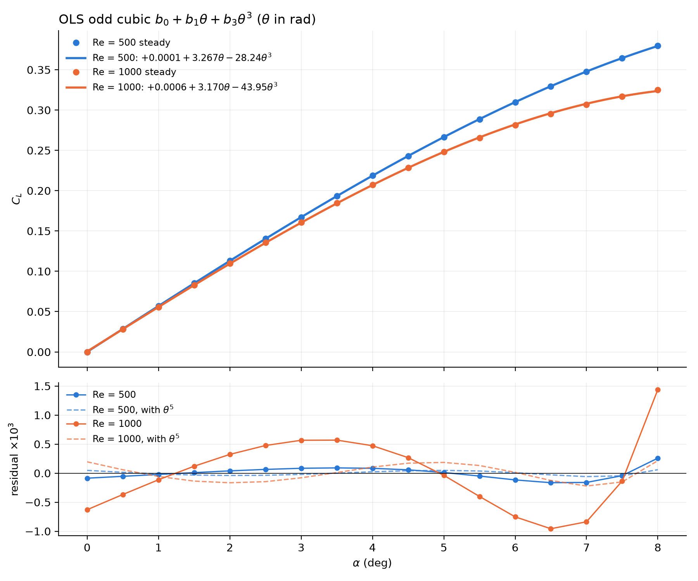

# Steady-lift Lasso analysis at Re = 1000 (vs Re = 500)

6 October 2026 · NACA0012, 2D laminar, steady (SIMPLE) base flow · `analysis/lasso_re1000.py`

## Summary

- **θ and θ³ carry the Re=1000 lift curve, the same as at Re=500.** At λ = 1e-4 both are selected in
  **100 %** of 500 bootstrap resamples at both Reynolds numbers. θ² and θ⁴–θ⁸ are zeroed.
- **One more odd term survives, and it is not negligible at Re=1000.** A θ⁹ term is active at
  λ = 1e-4 at both Re. It is also in your original Re=500 path: +0.0034 standardized at
  λ = 1e-4 in `analysis/figs/lasso_coefficient_path.csv`. At Re=500 it is small (1.7 % of the θ
  coefficient, selected in 92 % of bootstraps). At Re=1000 it is **8 % of θ and selected in 100 %**.
- **An odd cubic is not enough at Re=1000.** OLS `b0 + b1θ + b3θ³` has an RMSE of 6.4e-3 at
  Re=1000, against 2.2e-3 at Re=500. The residuals form a systematic S-shape up to 0.015. Adding
  θ⁵ cuts the RMSE **18×** at Re=1000 (7× at Re=500). The quintic intercept then falls to −5e-4,
  consistent with the symmetry requirement C_L(0) = 0.
- **Cause: the Re=1000 steady lift curve saturates early.** C_L rises at nearly the same slope as
  Re=500 to about 3°, then flattens to C_L ≈ 0.34–0.35 from 9° to 12°. Re=500 is still climbing
  through 0.45 there. The faster bend needs a higher odd power.
- **Restricting the fit to 0–8° makes θ + θ³ sufficient at Re=1000.** This range is below the
  Re=1000 shedding onset (8–10°). An odd-only Lasso (θ, θ³, θ⁵, θ⁷, θ⁹) keeps θ and θ³ in 100 % of
  bootstraps, with θ⁵ at 0.7 % of θ³. OLS gives C_L ≈ 3.170θ − 43.95θ³, with a maximum error of
  1.4e-3, under 0.5 % of C_L. The unrestricted 0–8° Lasso also picks a small θ⁴, but that is a
  collinearity stand-in that cannot be physical. See
  [Restricted range: 0–8°](#restricted-range-08-below-the-re1000-shedding-onset).
- All 25 angles in the fit range (0–12° in 0.5° steps) converged. At 14–20°, SIMPLE at Re=1000
  found **no fixed point**, so those angles are plotted but kept out of every fit.

## What was run

### Mesh: same M2 recipe, first cell rescaled by Blasius

The Re=500 steady cases used `meshes/M2_ns160_nr180_b025.msh` (63,360 cells). I recovered its
exact generator arguments (R = 30 was measured from the node coordinates). Rerunning them at
`--re 500` reproduces the existing file **byte for byte** (`cmp`), so the recipe is confirmed.
The Re=1000 mesh changes only `--re`:

```bash
cd meshing && /home/raji/miniconda3/envs/research/bin/python mesher.py \
    ../meshes/M2_ns160_nr180_b025_re1000.msh --re 1000 -r 30 --nr 180 --ns 160 --nte 32 --bump 0.25
```

The Blasius rule h₁ = 0.05/√Re gives h₁ = **1.581e-3** at Re=1000, against 2.236e-3 at Re=500.
Topology, cell count, far field and TE resolution are otherwise identical.

| | Re = 500 (M2) | Re = 1000 |
|---|---|---|
| cells | 63,360 | 63,360 |
| h₁ | 2.236e-3 | 1.581e-3 |
| max non-orthogonality | 64.08° | 64.32° |
| max skewness | 0.821 | 0.728 |
| max aspect ratio | 7.50 | 6.05 |
| checkMesh | Mesh OK | Mesh OK |

### Cases

- Built with `make_steady.sh`, unchanged. It uses the transient case's `linearUpwind` with only
  `ddt` set to `steadyState`, 2 non-orthogonal correctors, U 0.7 / p 0.3 relaxation, and 6000
  SIMPLE iterations. Both dictionaries were checked with `foamDictionary`.
- **Fit range:** 0–12° in 0.5° steps, 25 angles: the grid of `lift_coeffs.csv` plus 10.5° and
  11.5°.
- **Extension:** 14, 16, 18 and 20°, kept out of the fit.
- **Execution:** sequential at **6 MPI ranks per case, one case at a time**, as you specified,
  using `STEADY_DIR=steady_re1000 ./run_steady.sh`. Wall time ran from about 150 s per case at
  low angles to about 380 s at 20°, roughly 1 h 45 min in total including the 12° pilot.

### Convergence, judged on the force trace

`python3 analysis/steady_summary.py --root steady_re1000`:

- **0–12°: all CONVERGED.** The C_L range over the last 10 % of iterations is ≤ 1e-8 at every
  angle.
- **14–20°: LIMIT-CYCLE.** The C_L range is identical across the 50 % and 10 % windows: 1.8e-3 at
  14°, 1.0e-2 at 16°, 1.9e-2 at 18° and 2.7e-2 at 20°. This is the signature of a strongly
  unstable base flow leaking into the iteration, the same pattern Re=500 shows at 22–24°. The
  last-iterate values are not fixed points, and they are drawn as × below.

### Cross-check against the August Re=1000 campaign

The steady C_L at 10° is **0.3442**. In `~/OpenFOAM/raji-dev/run/Aug/unsteadyRe1000/FINDINGS.md`,
the time-accurate α = 10° run passes through a quiet window at t = 8–12. There it sits at a
quasi-steady **C_L ≈ 0.353** before the instability regrows, i.e. close to the unstable fixed
point. That run used a different mesh (22k/88k cells), and the two agree to 2.5 %.

The August *steady* value of 0.459 used first-order `upwind`. `make_steady.sh` deliberately does
not use it, so that number is not comparable.

## Results

### Steady lift and drag



| α (°) | C_L, Re 500 | C_L, Re 1000 | C_D, Re 500 | C_D, Re 1000 |
|---:|---:|---:|---:|---:|
| 0 | 0.0000 | 0.0000 | 0.1741 | 0.1207 |
| 2 | 0.1130 | 0.1097 | 0.1755 | 0.1220 |
| 4 | 0.2187 | 0.2075 | 0.1795 | 0.1257 |
| 6 | 0.3097 | 0.2814 | 0.1863 | 0.1322 |
| 8 | 0.3797 | 0.3251 | 0.1960 | 0.1413 |
| 10 | 0.4261 | 0.3442 | 0.2083 | 0.1527 |
| 12 | 0.4523 | 0.3512 | 0.2229 | 0.1655 |

The full tables are in [`steady_coeffs_re1000.csv`](analysis/figs/re1000_steady/steady_coeffs_re1000.csv)
and [`steady_coeffs_re500.csv`](analysis/figs/re1000_steady/steady_coeffs_re500.csv).

- **Small-angle slope:** C_L(0.5°)/θ is 3.27 per rad at Re=500 and 3.20 at Re=1000, about half of
  the thin-airfoil 2π at both.
- **Lift is lower at the higher Re:** 22 % lower at 12°. This is the same direction August found
  between Re=100 and Re=1000, where suction-side separation decambers the section.
- **Drag** is about 30 % lower at Re=1000, as expected from the thinner viscous layer.

### Lasso coefficient path, Re = 1000

The pipeline is the same as `lasso_path.py`: degree-9 `PolynomialFeatures` in θ (radians),
`StandardScaler`, and a LARS-Lasso path. The values at λ = 1e-4 were re-solved by coordinate
descent with tol = 1e-12.



For comparison, the same 25-point grid at Re=500:



### Coefficients at λ = 1e-4, and how stable the selection is



| term | std. coef, Re 500 | std. coef, Re 1000 | raw coef, Re 500 | raw coef, Re 1000 | bootstrap, Re 500 | bootstrap, Re 1000 |
|---|---:|---:|---:|---:|---:|---:|
| θ | +0.2017 | +0.1925 | +3.205 | +3.058 | 1.00 | 1.00 |
| θ² | 0 | 0 | 0 | 0 | 0.00 | 0.20 |
| θ³ | −0.0711 | −0.1068 | −25.79 | −38.70 | 1.00 | 1.00 |
| θ⁴ | 0 | 0 | 0 | 0 | 0.05 | 0.00 |
| θ⁵–θ⁸ | 0 | 0 | 0 | 0 | 0.00 | 0.00 |
| θ⁹ | +0.0034 | +0.0154 | +1.83e4 | +8.15e4 | 0.92 | 1.00 |
| intercept | | | +0.00235 | +0.00423 | | |
| training RMSE | | | 1.15e-3 | 2.09e-3 | | |

The θ³ coefficient is **50 % larger** at Re=1000 (standardized −0.107 vs −0.071). The cubic
correction does more of the work because the curve bends harder.

**The active set depends on λ.** On θ ∈ [0, 0.21] rad, the powers θᵏ are nearly collinear after
standardization. At a large penalty, Lasso therefore swaps one high power for another.

| λ | active set, Re 500 | active set, Re 1000 |
|---|---|---|
| 1e-2 | θ, θ⁹ | θ, θ⁹ |
| 3e-3 | θ, θ⁶ | θ, θ⁵ |
| 1e-3 | θ, θ⁴ | θ, θ³, θ⁴ |
| 3e-4 | θ, θ³, θ⁴ | θ, θ³, θ⁹ |
| **1e-4** | **θ, θ³, θ⁹** | **θ, θ³, θ⁹** |
| 3e-5 | θ, θ³, θ⁹ | θ, θ², θ³, θ⁸ |
| 1e-5 | θ, θ², θ³, θ⁸, θ⁹ | θ, θ², θ³, θ⁷ |

- θ and θ³ are the only terms that persist across a wide band of λ, 3e-4 to 1e-6, at both Re.
- The third term at large λ is whichever high power happens to absorb the curvature (θ⁴, θ⁵, θ⁶
  or θ⁹). It should be read as "some higher-order odd correction", not as θ⁹ specifically.

**Cross-validation does not choose a sparse model.** Leave-one-out CV picks λ at the floor of the
grid: 1e-8 at Re=500 (all 9 terms) and 1.5e-7 at Re=1000 (7 terms). The reason is that the data
are deterministic CFD with no sampling noise, so any penalty only adds bias. Sparsity here is a
**modelling choice** made by fixing λ, not something the data infer. The λ = 1e-4 sets are
defensible because their training RMSE (1–2e-3) is well below the scale of any physical effect in
question. A penalty does not reveal a "true" sparse law.

### Is θ, θ³ enough? An OLS check



| model | Re | b0 | b1 | b3 | b5 | R² | RMSE | max \|res\| |
|---|---|---:|---:|---:|---:|---:|---:|---:|
| odd cubic | 500 | +2.73e-3 | 3.1817 | −24.22 | – | 0.999764 | 2.18e-3 | 5.71e-3 |
| odd cubic | 1000 | +9.10e-3 | 2.8902 | −30.28 | – | 0.996676 | 6.41e-3 | 1.50e-2 |
| odd quintic | 500 | −5.16e-4 | 3.2987 | −32.56 | +150.2 | 0.9999954 | 3.05e-4 | 5.16e-4 |
| odd quintic | 1000 | −5.39e-4 | 3.2375 | −55.02 | +445.8 | 0.9999898 | 3.54e-4 | 5.39e-4 |

What the residual panel shows:

- **The Re=1000 cubic is structurally wrong, not just less accurate.** Its residual is a clean
  S-curve, and it predicts a lift maximum near 10.2° followed by a *drop*. The data have no drop.
  Its intercept of +9e-3 is an artefact of forcing a cubic onto the curve, since symmetry requires
  C_L(0) = 0.
- **θ⁵ fixes it.** With θ⁵ added, both Re sit at the same ~3e-4 RMSE floor, and both intercepts
  collapse to −5e-4.
- **The higher-order term grows with Re.** b5/b1 is 46 at Re=500 and 138 at Re=1000.
- **For a reduced-order model at Re=1000:** C_L = b1θ + b3θ³ + b5θ⁵ is the smallest polynomial
  that is accurate over 0–12°. If the range is restricted to the near-linear part (≲ 6°), θ, θ³
  is adequate.

## Restricted range: 0–8°, below the Re=1000 shedding onset

**Why rerun.** The August campaign bracketed the Re=1000 onset between 8° and 10°: at 8° the
time-accurate run stayed steady, with a C_L amplitude of only 0.0015. So 0–8° is the range where
the steady solution is, as far as anything measured shows, the flow that actually occurs. It also
excludes the flattening above about 9° that drove the θ⁹ and θ⁵ terms over 0–12°.

The pipeline is otherwise unchanged: 17 angles in 0.5° steps, all converged, the same 17 at both Re.

```bash
/home/raji/miniconda3/envs/research/bin/python analysis/lasso_re1000.py --amax 8          # all powers 1-9
/home/raji/miniconda3/envs/research/bin/python analysis/lasso_re1000.py --amax 8 --odd    # 1, 3, 5, 7, 9
```

### Full degree-9 Lasso, 0–8°



| term | std. coef, Re 500 | std. coef, Re 1000 | bootstrap, Re 500 | bootstrap, Re 1000 |
|---|---:|---:|---:|---:|
| θ | +0.1359 | +0.1337 | 1.00 | 1.00 |
| θ³ | −0.0100 | −0.0323 | 0.72 | 0.96 |
| θ⁴ | −0.0103 | −0.0028 | 0.99 | 0.97 |
| others | 0 | 0 | ≤ 0.06 | ≤ 0.01 |

- **Below λ ≈ 8e-5, only θ and θ³ carry weight at Re=1000.** Every other term stays within
  ±0.003 of zero.
- **θ⁴ is an artifact, not physics.** λ = 1e-4 sits exactly where θ⁴ is fading out of the path,
  and at 3e-5 it is gone. C_L is odd in α, so an even power cannot be physical. On one-sided data
  over [0, 0.14] rad, θ⁴ is nearly collinear with θ³ and θ⁵, and Lasso borrows it as a stand-in.
- **The θ⁹ from the 0–12° fit has gone** (kept in 1 % of resampled fits). It existed only to
  absorb the flattening above 9°.

### Odd-only Lasso, 0–8°: θ, θ³, θ⁵, θ⁷, θ⁹

Restricting the candidates to odd powers builds the symmetry C_L(−α) = −C_L(α) into the model, so
Lasso can no longer substitute an even power.





| term | std. coef, Re 500 | std. coef, Re 1000 | raw coef, Re 500 | raw coef, Re 1000 | bootstrap, Re 500 | bootstrap, Re 1000 |
|---|---:|---:|---:|---:|---:|---:|
| θ | +0.1368 | +0.1343 | +3.200 | +3.141 | 1.00 | 1.00 |
| θ³ | −0.0170 | −0.0354 | −20.27 | −42.21 | 0.97 | 1.00 |
| θ⁵ | −0.0041 | −0.00024 | −265.9 | −15.9 | 1.00 | 0.83 |
| θ⁷ | 0 | 0 | 0 | 0 | 0.00 | 0.00 |
| θ⁹ | 0 | 0 | 0 | 0 | 0.00 | 0.00 |
| intercept | | | +0.00169 | +0.00154 | | |
| training RMSE | | | 7.83e-4 | 7.95e-4 | | |

| λ | active set, Re 500 | active set, Re 1000 |
|---|---|---|
| 1e-3 | θ, θ⁷ | θ, θ⁵ |
| 3e-4 | θ, θ³, θ⁵ | θ, θ³, θ⁵ |
| **1e-4** | **θ, θ³, θ⁵** | **θ, θ³, θ⁵** |
| 3e-5 | θ, θ³, θ⁵ | θ, θ³, θ⁹ |
| 1e-5 | θ, θ³, θ⁹ | θ, θ³, θ⁹ |

**Re=1000: the model is θ + θ³.**

- θ and θ³ are both selected in 100 % of 500 resampled fits.
- θ⁵ is nominally active at λ = 1e-4, but its standardized coefficient is −0.00024: 0.7 % of θ³
  and 0.2 % of θ, effectively zero.
- Below λ = 1e-4 the path is flat, with θ and θ³ only and the other odd terms within ±0.002 of
  zero.

**Re=500: θ⁵ is relatively larger, but most likely a shrinkage artifact.** Over 0–8° the Re=500
curve is nearly linear, so θ³ is weak (−0.017, against −0.035 at Re=1000). θ⁵ is −0.0041, a
quarter of θ³. But its sign disagrees with ordinary least squares:

| | b3 | b5 |
|---|---:|---:|
| Lasso, Re=500 | −20.3 | −266 |
| OLS quintic, Re=500 | −29.4 | **+48.5** |

The penalty shrinks θ³, and θ⁵, which is nearly collinear with it, takes up the slack with the
same sign. Without the penalty, the θ⁵ coefficient is small and of the opposite sign. Re=1000
shows the same pattern (Lasso −15.9, OLS +298), but there the term is negligible either way.

### OLS check, 0–8°



| model | Re | b0 | b1 | b3 | b5 | RMSE | max \|res\| |
|---|---|---:|---:|---:|---:|---:|---:|
| odd cubic | 500 | +8.66e-5 | 3.2674 | −28.236 | – | 1.03e-4 | 2.58e-4 |
| odd cubic | 1000 | +6.29e-4 | 3.1703 | −43.951 | – | 6.07e-4 | 1.44e-3 |
| odd quintic | 500 | −4.74e-5 | 3.2749 | −29.445 | +48.5 | 3.68e-5 | 5.97e-5 |
| odd quintic | 1000 | −1.95e-4 | 3.2165 | −51.389 | +298.5 | 1.43e-4 | 2.22e-4 |

- **The Re=500 cubic reproduces `analysis/fit_odd_cubic_8deg.py` exactly**
  (0.000086595934 + 3.267395529θ − 28.235887546θ³), so this run uses the same data as yours.
- **The Re=1000 θ + θ³ fit is about 10× tighter on 0–8° than on 0–12°:** RMSE 6.1e-4 vs 6.4e-3.
  Its worst error, 1.4e-3, is under 0.5 % of C_L(8°) = 0.325.
- **The cubic correction is much stronger at Re=1000:** b3/b1 is −13.9, against −8.6 at Re=500.

**Conclusion for 0–8°.** With the symmetry built in, Lasso at Re=1000 selects θ + θ³. The least-
squares form is C_L ≈ 3.170θ − 43.95θ³. A θ⁵ term buys a 4× lower RMSE, but the cubic error is
already below 0.5 % of C_L.

## Caveats

1. **Part of the 0–12° fit range is an unstable branch at Re=1000.** August bracketed the Re=1000
   shedding onset between 8° and 10°, against α_c = 11.46° at Re=500. A larger share of the
   Re=1000 fit range is therefore the unstable steady branch, which is the quantity defined in
   `analysis/LIFT_FIT_LITERATURE.md`, not the time-mean lift. Do not compare these coefficients
   with time-averaged C_L.
2. **No mesh-independence study at Re=1000.** The mesh is the Re=500 M2 mesh with Blasius-scaled
   h₁, and the only external check is the 2.5 % agreement at 10° with August's different mesh.
   `mesh_convergence_M1/` exists for Re=500 only.
3. **A different 25-point grid from your Re=500 run.** For a like-for-like comparison, both Re
   here use the same 25 angles, so Re=500 includes 10.5° and 11.5°, which `lift_coeffs.csv`
   omits. Your 23-point Re=500 path shows the same structure (θ, θ³ and a small θ⁹ at 1e-4), so
   the conclusion does not depend on the grid.
4. **Mild leakage in LOO-CV.** `LassoCV` standardizes once on the full set before splitting. With
   deterministic data and λ driven to the floor, this does not change the conclusion.

## File layout and changes

**Re=500 steady cases moved.** All 49 `steady_aoa*` case directories, their 49 `*.build.log`,
`run_steady.log` and `run_steady_serial_aborted.log` moved from the repo root into
**`steady_re500/`**. Nothing was deleted. `lift_coeffs.csv` stays at the root because six analysis
scripts read it from there.

**New Re=1000 data, in `steady_re1000/`:**

- `steady_aoa{0..11.5 step 0.5, 12, 14, 16, 18, 20}/` and their build logs
- `sweep.sh`, the driver that built and ran the sweep
- `run_steady.log` and `run_pilot.log`
- `lift_coeffs_re1000.csv`, 0–12° in the same format as `lift_coeffs.csv`, so `lasso_reg.py` etc.
  can be pointed at it
- `lift_coeffs_re1000_all.csv`, which adds the **non-converged** 14–20° values

**Mesh:** `meshes/M2_ns160_nr180_b025_re1000.msh`.

**Analysis:** `analysis/lasso_re1000.py`. It writes everything to `analysis/figs/re1000_steady/`:
the four figures above, `lasso_summary.txt` (the full numeric output),
`lasso_path_re{500,1000}.csv` and `steady_coeffs_re{500,1000}.csv`. Options: `--amax 8` sets the
fit range and writes to `analysis/figs/re1000_steady_0to8deg/`; `--odd` restricts the features to
odd powers and appends `_odd` to that folder name. The 0–12° defaults write to the original folder,
so the figures above are never overwritten.

**Scripts repointed for the move.** Defaults preserve the old behaviour for Re=500.

| script | change |
|---|---|
| `run_steady.sh` | cases resolved under `$STEADY_DIR`, default `steady_re500` |
| `extract_lift_coeffs.sh` | optional `[caseRoot] [out.csv]`, default `steady_re500` → `lift_coeffs.csv` |
| `analysis/steady_summary.py` | `--root` (default `steady_re500`); fractional angles listed; the Re=500 unsteady-mean table is printed only for `steady_re500` |
| `analysis/fit_odd_cubic_8deg.py`, `analysis/check_odd_cubic.py` | glob `steady_re500/steady_aoa*` |
| `CLAUDE.md` | command block updated |

## Reproduce

```bash
python3 analysis/steady_summary.py --root steady_re1000
/home/raji/miniconda3/envs/research/bin/python analysis/lasso_re1000.py
# rerun the sweep (rebuilds cases):  steady_re1000/sweep.sh
```
