# Steady-lift odd-term fits across Re = 100, 500, 1000, 2000

6 October 2026 · NACA0012, 2D laminar, steady (SIMPLE) base flow · task: `instructions/oct6_reSweep.md`

Companion to [`STEADY_LASSO_Re1000.md`](STEADY_LASSO_Re1000.md), which covers Re = 500 vs 1000 in
detail. This report adds Re = 100 and Re = 2000, compares all four, and records the unsteady
Re = 2000 run.

## Summary

- **The claim in the instructions holds over 0–8° at Re = 500, 1000 and 2000.** The odd-only Lasso
  keeps θ and θ³ in ≥ 97 % of 500 bootstrap resamples at each. At Re = 100 it does not.
- **Re = 100 is different because its lift curve is nearly linear.** On 0–8° its least-squares
  cubic ratio is b3/b1 = −3.1, against −8.6 at Re = 500. The θ³ correction is then close to the
  size of the λ = 1e-4 penalty, and Lasso swaps it for θ⁵: θ³ is kept in only 37 % of resamples
  and θ⁵ in 98 %. The cubic is nonetheless an excellent fit at Re = 100: RMSE 2.9e-5 over 0–8°.
- **Re = 2000 needs care over 0–8°.** Its lift curve already bends hard by 6–8° (C_L = 0.228 at
  6°, 0.247 at 9°). The θ³ fit leaves a 5e-3 residual, and Lasso adds θ⁹ (selected in 89 % of
  resamples). This is the same effect seen at Re = 1000 over 0–12°. Over 0–6° Re = 2000 is
  θ + θ³ again.
- **Which terms Lasso keeps at fixed λ depends on the fit range; the least-squares θ³
  coefficient does not.** Over 0–6°, Lasso at λ = 1e-4 drops θ³ entirely at Re = 100 and keeps it
  in only 49 % of resamples at Re = 500. Yet the plain least-squares b3 is unchanged between the
  two ranges: Re = 500 gives −28.7 on 0–6° vs −28.2 on 0–8°, and Re = 100 gives −10.0 vs −9.8.
  The λ = 1e-4 penalty is not scale-free, so it reads a smaller curvature signal as "not
  selected".
- **The cubic coefficient grows like a power of Re, but the exponent drifts.** Four Re gave
  |b3| ≈ 0.48 Re^0.66 over 0–6°. Seven more Re (200–900, added 2026-10-07, all converged) show
  the local exponent rising from 0.62 (Re 100–200) to a plateau of 0.71–0.72 (Re 500–900) and
  falling to 0.63 towards Re = 2000; the best single law over Re 200–1000 is **Re^0.70**, within
  1 %. b1 stays between 2.9 and 3.3 per rad. See
  [Re-scaling check](#re-scaling-check-seven-more-re-between-100-and-1000).
- **The odd Legendre basis gives the same answer in stable coordinates.** Rescaling to
  x = θ/θ_max ∈ [−1, 1] (mirrored by symmetry) and fitting P1, P3, P5, P7, P9 gives c1 ≈ 0.30–0.42
  and |c3/c1| = 2.6 % → 22 % from Re = 100 to 2000. Higher terms decay fast except at Re = 2000,
  where c5 is 12 % of c3. Collected back into θ, the θ and θ³ coefficients are robust and the
  θ⁵–θ⁹ coefficients are not. See
  [Odd Legendre basis](#odd-legendre-basis-on-the-symmetric-rescaled-angle).
- **SIMPLE behaviour by Re:**

  | Re | SIMPLE converges | first oscillating angle |
  |---|---|---|
  | 100 | every angle, 0–20° | none |
  | 500 | through 20° | 22° |
  | 1000 | through 12° | 14° |
  | 2000 | through 9° | **9.5°** |

- **The unsteady Re = 2000 run at 9.5° sheds.** At 9.5°, the first angle where SIMPLE oscillates,
  the run reaches a period-1 limit cycle by t ≈ 20 with f = 1.10 and C_L = 0.441 ± 0.087. The
  whole cycle sits above the steady branch: the minimum instantaneous C_L, 0.361, is 0.11 above
  the steady 0.247. The run was stopped at t = 30.3, once shedding was confirmed. See
  [below](#unsteady-re--2000-at-95).

## What was run

### Meshes: M2 recipe, first cell rescaled by Blasius (h₁ = 0.05/√Re)

All four meshes come from the same command, differing only in `--re`:

```bash
cd meshing && /home/raji/miniconda3/envs/research/bin/python mesher.py \
    ../meshes/M2_ns160_nr180_b025_re<RE>.msh --re <RE> -r 30 --nr 180 --ns 160 --nte 32 --bump 0.25
```

The Re = 500 file `M2_ns160_nr180_b025.msh` was previously confirmed byte-identical to this recipe.

| Re | h₁ | cells | max non-orth. | max skewness | max aspect | checkMesh |
|---|---:|---:|---:|---:|---:|---|
| 100 | 5.00e-3 | 63,360 | 63.6° | 1.86 | 14.3 | OK |
| 500 | 2.24e-3 | 63,360 | 64.1° | 0.82 | 7.5 | OK |
| 1000 | 1.58e-3 | 63,360 | 64.3° | 0.73 | 6.0 | OK |
| 2000 | 1.12e-3 | 63,360 | 64.5° | 0.73 | 8.3 | OK |

Re = 100 has the highest skewness and aspect ratio, because its thick 5e-3 first cell sits against
the fixed tangential spacing. Both are still within checkMesh limits.

### Steady cases

- Built with `make_steady.sh`, unchanged: the transient `linearUpwind` scheme with ddt set to
  `steadyState`, 6000 SIMPLE iterations.
- **Grid** for both new Re: 0–12° in 0.5° steps, plus 14, 16, 18 and 20°, i.e. 29 cases each.
- **Execution:** sequential, one case at a time on 6 MPI ranks, Re = 2000 first, then Re = 100.
  Each case took 150–390 s; the two sweeps together took about 3.5 h.
- **Location:** `NACA0012/steady_re100/` and `NACA0012/steady_re2000/`, each with its `sweep.sh`, build logs,
  `run_pilot.log` (12°) and `run_steady.log`. The chain driver is `NACA0012/steady_re2000/chain_sweeps.sh`.

### Convergence, judged on the force trace

From `python3 analysis/steady_summary.py --root steady_re<RE>`:

- **Re = 100:** CONVERGED at all 29 angles, 0–20°. The C_L range over the last 10 % is ≤ 3e-7.
- **Re = 2000:**
  - **0–9°: CONVERGED**, with the range over the last 10 % ≤ 1e-8.
  - **9.5–20°: LIMIT-CYCLE.** The range is identical across the 50 % and 10 % windows and grows
    steadily with angle: 1.9e-3 at 9.5°, 4.1e-3 at 10°, 1.4e-2 at 12°, 5.1e-2 at 18° and 0.30
    at 20°.

Only CONVERGED cases enter any fit. In every fit range used here (≤ 8°), all four Re are fully
converged.

## Results

### Steady lift and drag, all four Re

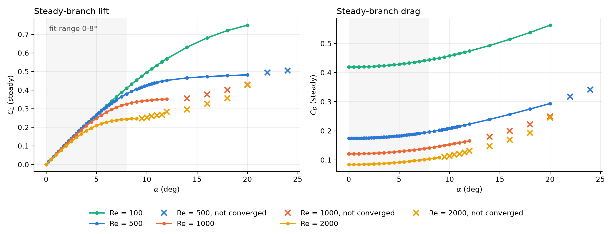

| α (°) | C_L Re 100 | C_L Re 500 | C_L Re 1000 | C_L Re 2000 | C_D Re 100 | C_D Re 2000 |
|---:|---:|---:|---:|---:|---:|---:|
| 0 | 0.0000 | 0.0000 | 0.0000 | 0.0000 | 0.4189 | 0.0843 |
| 2 | 0.1089 | 0.1130 | 0.1097 | 0.1004 | 0.4205 | 0.0854 |
| 4 | 0.2153 | 0.2187 | 0.2075 | 0.1812 | 0.4252 | 0.0889 |
| 6 | 0.3166 | 0.3097 | 0.2814 | 0.2277 | 0.4329 | 0.0950 |
| 8 | 0.4105 | 0.3797 | 0.3251 | 0.2442 | 0.4437 | 0.1033 |
| 12 | 0.5687 | 0.4523 | 0.3512 | (0.283, LC) | 0.4739 | (0.132, LC) |
| 20 | 0.7490 | 0.4821 | (0.430, LC) | (0.426, LC) | 0.5626 | (0.245, LC) |

(LC = SIMPLE limit cycle: the last iterate, not a fixed point.) Full tables:
[Re 100](analysis/figs/resweep_steady_0to8deg_odd/steady_coeffs_re100.csv),
[Re 2000](analysis/figs/resweep_steady_0to8deg_odd/steady_coeffs_re2000.csv).

- **The four curves share one initial slope** (about 3.1–3.3 per rad) and then **peel off in
  order of Re**: the higher the Re, the earlier and harder the curve bends.
- **At Re = 100 the curve keeps climbing to 20°** (0.75), with no saturation in range.
- **At Re = 2000 it is nearly flat from 7° to 9°** (0.239 → 0.247), right up to the angle where
  SIMPLE starts to oscillate.
- **Drag falls about 5× from Re = 100 to Re = 2000** (0.419 → 0.084 at 0°), as the viscous layer
  thins.

### Odd-only Lasso over 0–8°: θ, θ³, θ⁵, θ⁷, θ⁹

The pipeline is the same as in `STEADY_LASSO_Re1000.md`: the features are standardized, the λ = 1e-4
values are re-solved by coordinate descent, and selection stability comes from 500 bootstrap
resamples.

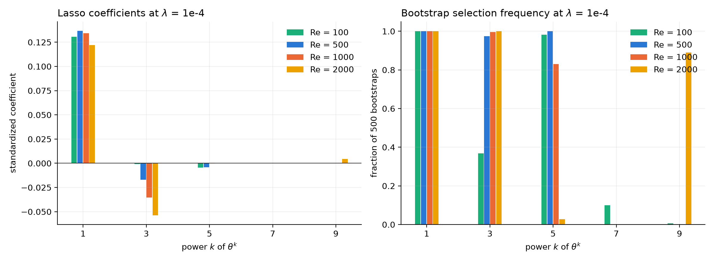

| term | Re 100 | Re 500 | Re 1000 | Re 2000 |
|---|---:|---:|---:|---:|
| θ | +0.1307 (1.00) | +0.1368 (1.00) | +0.1343 (1.00) | +0.1220 (1.00) |
| θ³ | −0.0009 (0.37) | −0.0170 (0.97) | −0.0354 (1.00) | −0.0537 (1.00) |
| θ⁵ | −0.0046 (0.98) | −0.0041 (1.00) | −0.0002 (0.83) | 0 (0.03) |
| θ⁷ | 0 (0.10) | 0 (0.00) | 0 (0.00) | 0 (0.00) |
| θ⁹ | 0 (0.01) | 0 (0.00) | 0 (0.00) | +0.0043 (0.89) |
| training RMSE | 7.8e-4 | 7.8e-4 | 7.9e-4 | 1.2e-3 |

Each cell is the standardized coefficient at λ = 1e-4, with the bootstrap selection frequency in
brackets.

- **The θ³ coefficient grows steadily with Re:** −0.001, −0.017, −0.035, −0.054. That is the
  "similar coefficient path" of the instructions, with the curvature growing as Re rises.
- **At the two ends the third term changes character.** At Re = 100 the cubic correction is too
  small for this λ, so Lasso puts it in θ⁵. At Re = 2000 the 0–8° range includes the knee of the
  curve, so θ⁹ appears.

Coefficient paths for each Re:

| Re 100 | Re 500 |
|---|---|
| 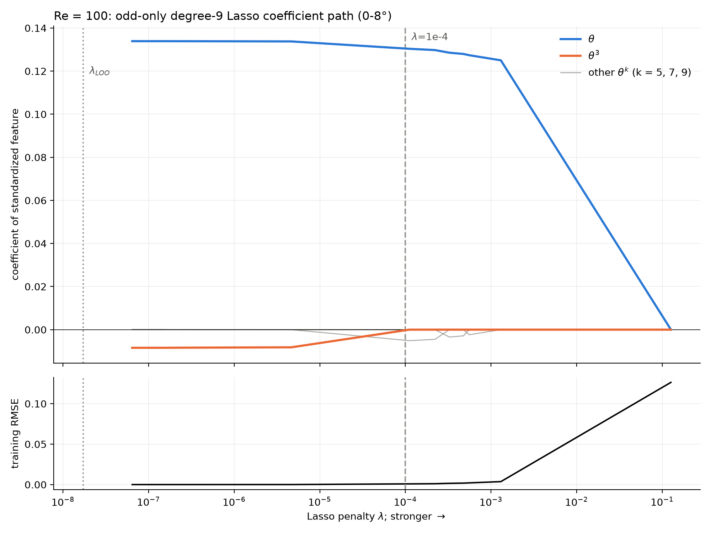 | 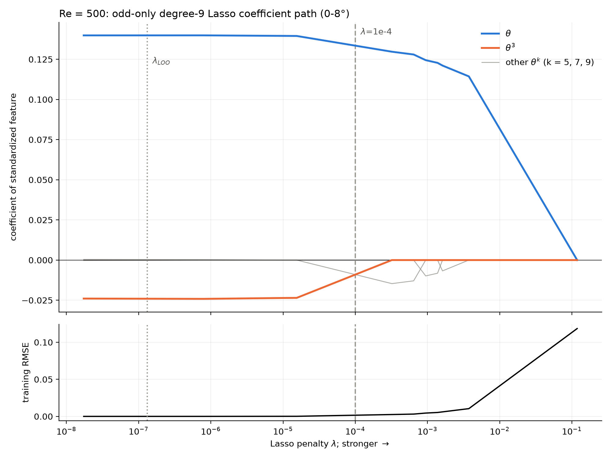 |
| **Re 1000** | **Re 2000** |
|  | 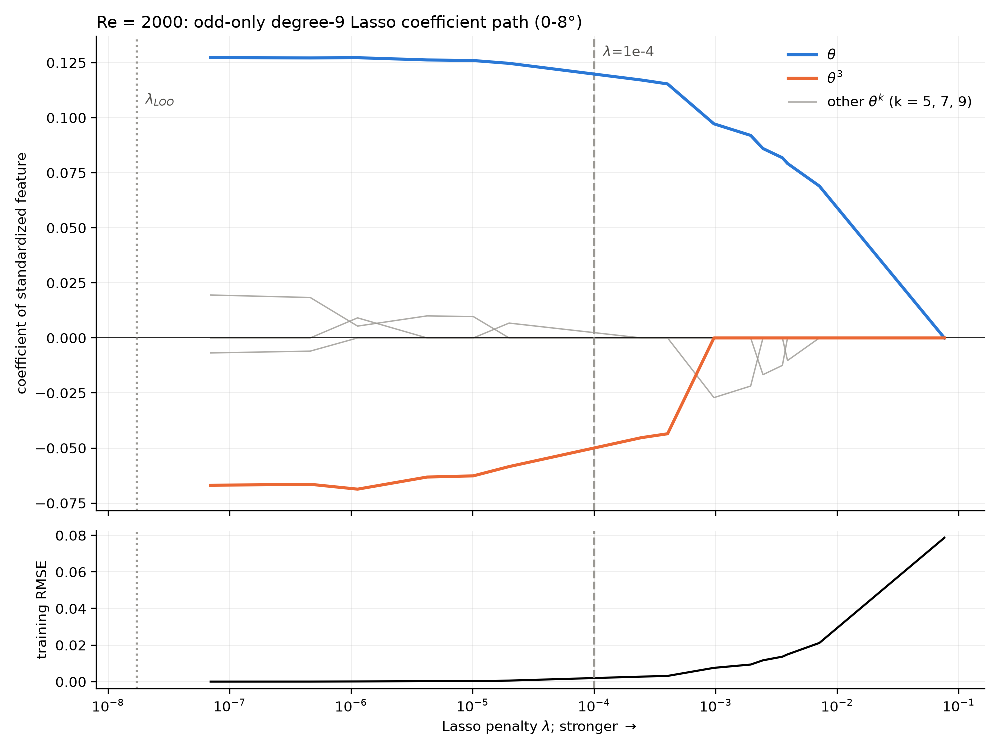 |

### Same analysis over 0–6°

Over 0–6° the Re = 2000 range sits below the knee.

| term | Re 100 | Re 500 | Re 1000 | Re 2000 |
|---|---:|---:|---:|---:|
| θ | +0.1005 (1.00) | +0.1037 (1.00) | +0.1015 (1.00) | +0.0943 (1.00) |
| θ³ | 0 (0.00) | −0.0028 (0.49) | −0.0099 (0.84) | −0.0230 (0.96) |
| θ⁵ | −0.0018 (0.55) | −0.0048 (0.96) | −0.0044 (0.99) | −0.0012 (0.97) |
| θ⁷ | −0.0001 (0.73) | 0 (0.07) | 0 (0.02) | 0 (0.01) |
| θ⁹ | 0 (0.20) | 0 (0.02) | 0 (0.01) | 0 (0.00) |

- **Re = 2000 recovers θ + θ³ as the dominant pair**, with θ⁵ at 5 % of θ³.
- **At Re = 100 and 500 the selection collapses.** The curvature over 0–6° is so small that
  λ = 1e-4 cannot see θ³, and it lets θ⁵ or θ⁷ stand in.
- **This is a property of the penalty, not of the flow.** The least-squares cubic over 0–6° fits
  Re = 100 and 500 to an RMSE of about 6e-6, and gives the same b3 as over 0–8°; see the table in
  the next section.

Figures: [coefficients](analysis/figs/resweep_steady_0to6deg_odd/lasso_coefficients_re100_vs_re500_vs_re1000_vs_re2000.png),
[least-squares fits](analysis/figs/resweep_steady_0to6deg_odd/odd_cubic_fit_re100_vs_re500_vs_re1000_vs_re2000.png),
and paths for [Re 100](analysis/figs/resweep_steady_0to6deg_odd/lasso_path_re100.png),
[Re 500](analysis/figs/resweep_steady_0to6deg_odd/lasso_path_re500.png),
[Re 1000](analysis/figs/resweep_steady_0to6deg_odd/lasso_path_re1000.png) and
[Re 2000](analysis/figs/resweep_steady_0to6deg_odd/lasso_path_re2000.png).

### The robust quantity: least-squares b1 and b3 versus Re

Because Lasso's selection depends on the range, the coefficient to compare across Re is the
least-squares fit C_L = b0 + b1θ + b3θ³ (`analysis/cubic_vs_re.py`).

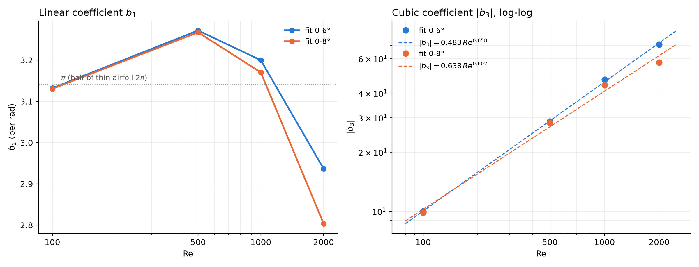

| Re | range | b1 | b3 | b3/b1 | RMSE | max \|res\| |
|---:|---|---:|---:|---:|---:|---:|
| 100 | 0–6° | 3.132 | −9.99 | −3.19 | 6.6e-6 | 1.2e-5 |
| 500 | 0–6° | 3.272 | −28.67 | −8.76 | 5.5e-6 | 8.8e-6 |
| 1000 | 0–6° | 3.200 | −46.87 | −14.65 | 4.5e-5 | 9.7e-5 |
| 2000 | 0–6° | 2.937 | −70.72 | −24.08 | 4.6e-4 | 9.1e-4 |
| 100 | 0–8° | 3.131 | −9.83 | −3.14 | 2.9e-5 | 6.1e-5 |
| 500 | 0–8° | 3.267 | −28.24 | −8.64 | 1.0e-4 | 2.6e-4 |
| 1000 | 0–8° | 3.170 | −43.95 | −13.86 | 6.1e-4 | 1.4e-3 |
| 2000 | 0–8° | 2.804 | −57.21 | −20.41 | 2.5e-3 | 5.3e-3 |

- **Power law (four Re; refined below):** |b3| = 0.483 Re^0.658 (0–6°), or 0.638 Re^0.602 (0–8°).
  The seven-Re check in [Re-scaling check](#re-scaling-check-seven-more-re-between-100-and-1000)
  shows the exponent is not constant; these values are averages over its drift. The 0–8° exponent is
  pulled down by Re = 2000, whose 0–8° b3 is contaminated by the knee: its fit error rises 5×,
  from 4.6e-4 to 2.5e-3. The 0–6° fit is the cleaner estimate.
- **b1 changes little with Re:** 2.94–3.27 per rad, about half the thin-airfoil 2π. Its dip at
  Re = 2000 again reflects the bend already starting by 6°.
- **For a reduced-order model,** C_L(θ, Re) ≈ b1θ − 0.48 Re^0.66 θ³ is a compact candidate below
  the knee. That is a suggestion for testing, not a validated law.

## Odd Legendre basis on the symmetric, rescaled angle

Script: `analysis/legendre_odd_fit.py --amax 8`. Outputs: `analysis/figs/legendre_odd_0to8deg/`.

**Setup.**

- **Rescaling:** angles are rescaled to x = θ/θ_max with θ_max = 8°, then mirrored with the
  NACA0012 symmetry C_L(−x) = −C_L(x), which gives 33 points on [−1, 1].
- **Model:** plain least squares (no penalty) on the odd Legendre polynomials,

  **C_L(x) = c1·P1(x) + c3·P3(x) + c5·P5(x) + c7·P7(x) + c9·P9(x)**

- **No intercept:** P0 is even and is excluded by the symmetry.
- **Mirroring changes nothing.** With an odd-only basis the residual at −x is minus the residual
  at x, so the mirrored and one-sided fits give identical coefficients. The script asserts this.
- **Conditioning:** the basis matrix has condition number 2.67, against the very ill-conditioned
  θ, θ³, …, θ⁹ monomials.

### Coefficients

| Re | c1 | c3 | c5 | c7 | c9 | RMSE | max \|res\| |
|---:|---:|---:|---:|---:|---:|---:|---:|
| 100 | +0.421113 | −0.0107544 | +9.716e-5 | +2.41e-6 | −6.5e-8 | 2.9e-8 | 5.7e-8 |
| 500 | +0.410197 | −0.0308952 | +2.617e-4 | +1.375e-4 | −1.6e-6 | 5.0e-7 | 1.1e-6 |
| 1000 | +0.371641 | −0.0488156 | +1.761e-3 | +5.497e-4 | −5.40e-5 | 2.8e-6 | 5.5e-6 |
| 2000 | +0.302190 | −0.0665334 | +8.262e-3 | +6.868e-4 | −4.104e-4 | 1.0e-5 | 2.4e-5 |

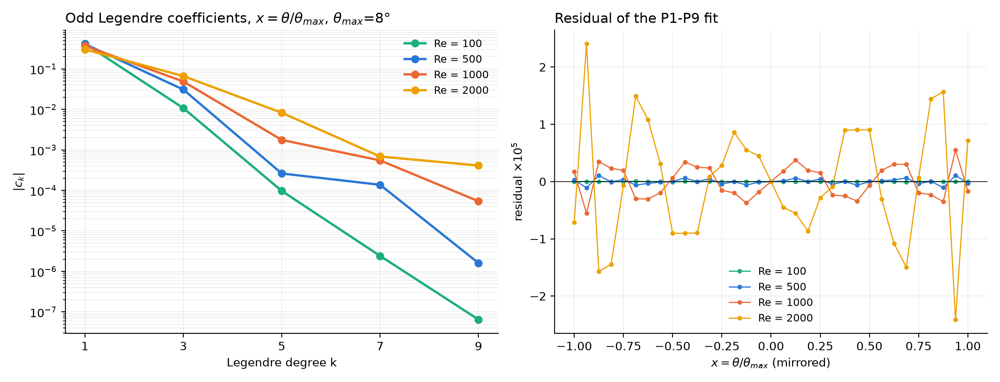

- **c1 and c3 carry the curve at every Re.** |c3/c1| is 2.6 %, 7.5 %, 13 % and 22 % for Re = 100,
  500, 1000 and 2000. This is the same steady growth with Re as the power law in b3 above.
- **The higher coefficients decay fast at low Re and slowly at high Re.** At Re = 100 each degree
  drops about two orders of magnitude. At Re = 2000, c5 is still 12 % of c3: the knee inside
  0–8° is a P5-scale feature there.
- **Some coefficients are below the resolution of the data.** `forceCoeffs` writes 7 significant
  digits, roughly 1e-7 in C_L. Re = 100's c7 and c9 (RMSE 2.9e-8) and probably Re = 500's c9 are
  therefore fitting rounding, not physics.

RMSE when the series is truncated (`legendre_truncation.csv`):

| Re | P1 | P1–P3 | P1–P5 | P1–P7 | P1–P9 |
|---:|---:|---:|---:|---:|---:|
| 100 | 4.4e-3 | 3.4e-5 | 7.2e-7 | 3.4e-8 | 2.9e-8 |
| 500 | 1.3e-2 | 1.1e-4 | 4.1e-5 | 6.6e-7 | 5.0e-7 |
| 1000 | 2.0e-2 | 6.7e-4 | 1.6e-4 | 1.5e-5 | 2.8e-6 |
| 2000 | 2.7e-2 | 2.9e-3 | 2.0e-4 | 1.1e-4 | 1.0e-5 |

**Truncation barely changes the leading coefficients.** Going from P1–P3 to P1–P9 moves c1 by less
than 0.3 % at every Re. c3 moves by less than 1 % for Re ≤ 1000 and by 2.6 % at Re = 2000.
Monomial fits do not behave this way.

### Collected back into θ

**Expanding each P_k(x) into powers of x = θ/θ_max and summing** gives C_L = Σ a_k θ^k. Two facts
explain the picture:

1. **Each Legendre term spills into every lower odd power.** For example P3 = (5x³ − 3x)/2 feeds
   both θ and θ³, and P5 feeds θ, θ³ and θ⁵.
2. **{P1, …, Pk} and {θ, …, θ^k} span the same space.** The collected P1–P3 fit *is* the least-
   squares fit C_L = a1θ + a3θ³ with no intercept, and so on for each truncation. Truncating in
   Legendre degree and truncating in θ power give the same model in different coordinates.

The figure shows each θ power's contribution at the edge of the range, a_k·θ_max^k (C_L units), for
three truncation levels.

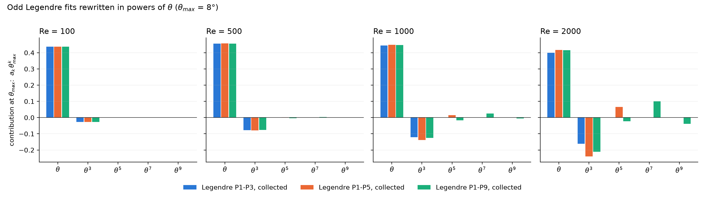

| Re | from | a1 | a3 | a5 | a7 | a9 |
|---:|---|---:|---:|---:|---:|---:|
| 100 | P1–P3 | 3.1314 | −9.859 | | | |
| 100 | P1–P5 | 3.1328 | −10.191 | +14.5 | | |
| 100 | P1–P9 | 3.1328 | −10.171 | +12.3 | +75 | −305 |
| 500 | P1–P3 | 3.2691 | −28.30 | | | |
| 500 | P1–P5 | 3.2736 | −29.31 | +44.3 | | |
| 500 | P1–P9 | 3.2711 | −28.20 | −77.6 | +3.87e3 | −7.56e3 |
| 1000 | P1–P3 | 3.1825 | −44.41 | | | |
| 1000 | P1–P5 | 3.2109 | −50.85 | +281 | | |
| 1000 | P1–P9 | 3.2002 | −45.80 | −331 | +2.47e4 | −2.54e5 |
| 2000 | P1–P3 | 2.8659 | −59.56 | | | |
| 2000 | P1–P5 | 2.9906 | −87.84 | +1236 | | |
| 2000 | P1–P9 | 2.9720 | −77.26 | −423 | +9.76e4 | −1.93e6 |

What the θ picture shows:

- **θ and θ³ are robust.** a1 agrees within 0.6 % between P1–P5 and P1–P9 at every Re (and
  within 4 % against P1–P3, the 4 % being at Re = 2000). a3 agrees within about 3 % between P1–P3
  and P1–P9 for Re ≤ 1000, with P1–P5 the outlier at Re = 1000 (−50.85), and within 30 % at
  Re = 2000. At the edge θ dominates,
  contributing +0.40 to +0.46, with θ³ taking −0.03 (Re = 100) to −0.21 (Re = 2000). The
  collected P1–P3 numbers match the earlier OLS cubic, which had a small intercept: Re = 500
  gives 3.269θ − 28.30θ³ here against 3.267θ − 28.24θ³ there.
- **The higher θ powers are not robust, even though the Legendre content behind them is.**
  At Re = 2000, a5 is +1236 from P1–P5 but −423 from P1–P9. Its edge contribution flips from
  +0.066 to −0.022, while a new θ⁷ term contributes +0.10 and θ⁹ −0.04 to compensate. These
  large, opposite-signed terms cancel almost exactly. This is the same instability that made the
  Lasso swap θ⁵, θ⁷ and θ⁹ in and out.
- **How to report the model:**
  - Quote the fit **as Legendre coefficients**, which are stable, near-orthogonal and directly
    comparable across Re.
  - Convert to θ **only at the truncation actually used.** For Re ≤ 1000 that is P1–P3,
    i.e. a1θ + a3θ³, which is accurate to ≤ 7e-4 RMSE.
  - At Re = 2000, keep P5 and quote the three-term collected form 2.991θ − 87.84θ³ + 1236θ⁵
    (RMSE 2.0e-4).
  - **Do not** read the θ⁵–θ⁹ coefficients of a P1–P9 collection as physical terms.

## Re-scaling check: seven more Re between 100 and 1000

Added 2026-10-07 to test the Re^0.66 law between its four original points. Same M2 recipe
(h₁ = 0.05/√Re), same 0–8° / 0.5° grid, SIMPLE at 6000 iterations, 6 ranks, one case at a time.

- **Cases:** `NACA0012/steady_re_scaling/steady_re{200,300,400,600,700,800,900}/steady_aoa*`, driver
  `NACA0012/steady_re_scaling/sweep.sh`, log `NACA0012/steady_re_scaling/run_steady.log`.
- **All 119 cases CONVERGED** on the force trace; every log reached `End`; every mesh passes
  `checkMesh` (max skewness 1.31 at Re = 200 falling to 0.73 at Re = 900).
- **Fit:** the odd-Legendre fit of the section above (x = θ/θ_max mirrored to [−1, 1], P1–P9,
  no intercept), now for all 11 Re (`analysis/legendre_vs_re.py`). The least-squares θ/θ³ fit
  (`cubic_vs_re.py --re ...`) gives the same exponents to within 0.01, as it must: for a pure
  cubic c3 = (2/5)·b3·θ_max³.
- **Grid independence of the coefficient:** c3 on the 0.5° grid agrees with the 1° grid to
  within 0.02 % at every Re and range. c3 moves by at most 0.2 % between the P1+P3, P1–P5 and
  P1–P9 fits for Re ≤ 1000 on 0–6° (1.3 % at Re = 2000).

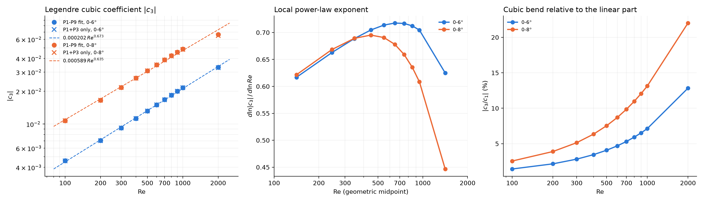

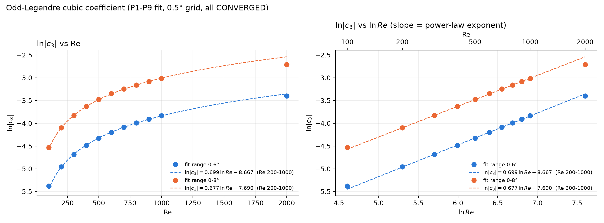

### c3 against Re

| Re | c1 (0–6°) | c3 (0–6°) | \|c3/c1\| (0–6°) | c1 (0–8°) | c3 (0–8°) | c5 (0–8°) |
|---:|---:|---:|---:|---:|---:|---:|
| 100 | 0.3211 | −0.004599 | 1.4 % | 0.4211 | −0.01075 | 9.7e-5 |
| 200 | 0.3271 | −0.007053 | 2.2 % | 0.4253 | −0.01655 | 1.2e-4 |
| 300 | 0.3275 | −0.009228 | 2.8 % | 0.4224 | −0.02170 | 1.3e-4 |
| 400 | 0.3257 | −0.01125 | 3.5 % | 0.4169 | −0.02646 | 1.7e-4 |
| 500 | 0.3229 | −0.01317 | 4.1 % | 0.4102 | −0.03090 | 2.6e-4 |
| 600 | 0.3194 | −0.01500 | 4.7 % | 0.4028 | −0.03504 | 4.2e-4 |
| 700 | 0.3155 | −0.01675 | 5.3 % | 0.3951 | −0.03890 | 6.4e-4 |
| 800 | 0.3114 | −0.01843 | 5.9 % | 0.3873 | −0.04248 | 9.4e-4 |
| 900 | 0.3072 | −0.02004 | 6.5 % | 0.3794 | −0.04578 | 1.3e-3 |
| 1000 | 0.3028 | −0.02159 | 7.1 % | 0.3716 | −0.04882 | 1.8e-3 |
| 2000 | 0.2594 | −0.03329 | 12.8 % | 0.3022 | −0.06653 | 8.3e-3 |

### The exponent is not constant

Local exponent d ln|c3| / d ln Re between neighbouring Re:

| range | 100→200 | 200→300 | 300→400 | 400→500 | 500→600 | 600→700 | 700→800 | 800→900 | 900→1000 | 1000→2000 |
|---|---:|---:|---:|---:|---:|---:|---:|---:|---:|---:|
| 0–6° | 0.617 | 0.663 | 0.689 | 0.705 | 0.714 | 0.718 | 0.717 | 0.712 | 0.705 | 0.625 |
| 0–8° | 0.622 | 0.668 | 0.689 | 0.695 | 0.691 | 0.678 | 0.659 | 0.636 | 0.609 | 0.447 |

- **ln|c3| against Re is strongly concave, so the growth is not exponential in Re.** Against
  ln Re it is close to a straight line, so the power law is the right family, but a curved one.
- **On 0–6° the exponent rises from 0.62 to a plateau of 0.71–0.72 over Re ≈ 500–900, then
  falls.** A single law over Re = 200–1000 fits to 1 %: **|c3| ∝ Re^0.699** (|b3| likewise
  ≈ Re^0.70). The four-point Re^0.66 was an average over this curvature, and the all-11-Re fit
  (Re^0.673) is the same average.
- **On 0–8° the exponent falls from Re ≈ 500 onward.** c5 grows 18× between Re = 100 and 1000
  (and 85× by Re = 2000): the 0–8° window increasingly contains the start of the knee, which
  bleeds into c3. The 0–8° exponents describe that mixture, not the cubic alone; quote 0–6°.
- **The Re = 1000→2000 slope rests on one wide interval.** Whether the drop to 0.63 is real or
  the 0–6° window also starting to see the knee at Re = 2000 (c5 there is 4 % of c3, against
  < 0.4 % at Re ≤ 1000) needs Re 1200–1800 to decide.
- **c1 is not monotone either:** it peaks around Re = 300 (0.3275 on 0–6°) and falls on both
  sides.

## Unsteady Re = 2000 at 9.5°

**Setup.**

- **Case:** `NACA0012/unsteady_re2000/re2000_aoa9.5/`, built by `make_case.sh` on the Re = 2000 mesh.
- **Run:** `NO_FIELDS=1 ./run_staged.sh … 6`, i.e. 6 MPI ranks and forces only. Phase 0 was the
  impulsive start at dt = 4e-5 to t = 0.5. Phase 1 used fixed-dt chunks of 20 time units, with dt
  re-tuned between chunks to 5.63e-4 and then 6.0e-4 (the `DT_MAX` ceiling). The sawtooth check
  gave 7.7 % step reversals, so the run is not corrupted.
- **Stopped at t = 30.35, on request, once shedding was confirmed.** The driver was stopped before
  the solver, so the interrupted chunk was **not** treated as a divergence. Its force data stays in
  `postProcessing/forceCoeffs/20.5/`, nothing was moved to `.diverged/`, and the stop is recorded
  in `driver.log`.
- **No fields were saved.** The only time directories are the phase-0 and chunk restart points.

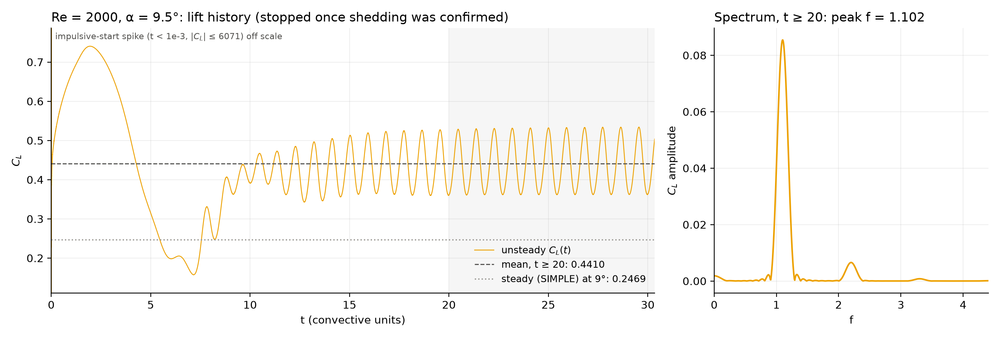

**Why shedding counts as confirmed.** `analysis/limit_cycle.py` at t = 30.15 reports:

| key | value | meaning |
|---|---|---|
| `SHEDDING` | yes | spectral prominence 1.2e5, far above the quiet-transient guard |
| `ORDER` | 1 | period-1; `SUBHARM_RATIO` = 0, `QUASIPERIODIC` = no |
| `FREQ` | 1.1002 | the zero-padded FFT of t ≥ 20 gives 1.102; harmonics at 2f and 3f only |
| `CL_MEAN`, `CL_P2P` | 0.4425, 0.1713 | t ≥ 20 directly: mean 0.4410, min 0.3605, max 0.5341 |
| `D_MEAN`, `D_P2P`, `D_FREQ` | 0.4 %, 0.8 %, 0.1 % | window-to-window agreement: `CONVERGED=yes` at the default tol |
| `CD_MEAN` | 0.1441 | |

`analysis/growth_rate.py` fits the envelope with σ = +0.0044 (R² = 0.92). The amplitude is flat to
very slowly growing, **not decaying**. That rules out the trap documented upstream, where an
impulsive-start disturbance decays to a quiet state. The figure also shows the order of events:
the start-up overshoot peaks at about t = 2, C_L dips to about 0.16 near t = 7, the instability
grows from t ≈ 8, and it saturates by t ≈ 20.

**What it means:**

- **Shedding onset at Re = 2000 is at or below 9.5°.** This is the same order as the Re = 1000
  bracket (8–10°) and well below Re = 500's 11.46°.
- **The run did not test whether shedding starts lower.** The 0–6° and 0–8° fit ranges for
  Re = 2000 are *assumed* preshedding, not shown to be. The cheapest check is an
  eigenvalue-style run (`run_marginal.sh`) at 8–9°.
- **The limit cycle does not orbit the steady state.** The time-mean C_L of 0.441 is 79 % above
  the steady branch. That is 0.247 at 9° (converged); the 9.5° steady value, 0.248, is only a
  SIMPLE last iterate. The minimum instantaneous C_L lies above the steady value by 0.66 of a
  peak-to-peak. At Re = 500 this gap was 0.44–0.94 (CLAUDE.md), so Re = 2000 shows the same
  geometry.
- **The record is short.** It stopped at about 11 cycles after saturation, and the amplitude was
  still creeping (D_P2P = 0.8 %). Treat the mean and amplitude as ±1 %. It is not a
  POD-quality record.

## Caveats

1. **Mesh independence has not been shown at Re = 100, 1000 or 2000.** Only Re = 500 has a mesh
   study (`NACA0012/mesh_convergence_M1/`). Re = 2000 is the most exposed: it uses the same tangential and
   radial cell counts with a thinner viscous layer.
2. **"Preshedding" is assumed, not measured, for Re = 100 and 2000.** The 0–8° and 0–6° ranges
   are below the SIMPLE-oscillation angle at every Re. But SIMPLE oscillation signals a *strongly*
   unstable base flow, so the physical shedding onset lies at or below that angle (at Re = 500,
   SIMPLE converged up to 20° while the eigenvalue onset is 11.46°). The unsteady 9.5° run confirms
   shedding there but does not bound the onset from below.
3. **The Re scaling is empirical and from one mesh family.** Eleven Re now, all on the M2
   recipe; no Re other than 500 has a mesh study. The exponent drifts (0.62 → 0.72 → 0.63), so
   no single power law should be quoted outside Re 200–1000. Re 1000–2000 has no interior point.
4. **2D laminar at Re = 2000** is a modelling assumption of the campaign, carried over unchanged.

## Files

**New Re = 100 and Re = 2000 data:**

- Steady cases in `NACA0012/steady_re100/` and `NACA0012/steady_re2000/`.
- The unsteady case in `NACA0012/unsteady_re2000/re2000_aoa9.5/`, with its driver log
  `NACA0012/unsteady_re2000/run_aoa9.5.log`.

**Meshes:** `meshes/M2_ns160_nr180_b025_re100.msh` and `meshes/M2_ns160_nr180_b025_re2000.msh`.

**Analysis code:**

- `analysis/lasso_re1000.py` gains `--re <list>`. Non-default lists write to
  `analysis/figs/resweep_steady_0to<amax>deg[_odd]/`. The defaults reproduce the earlier
  Re = 500/1000 outputs exactly; this was regression-checked against `lasso_summary.txt`.
- The lift/drag figure now uses one shared legend below the panels, because inside the axes it
  covered data.
- New `analysis/cubic_vs_re.py` writes the least-squares b1 and b3 table and the power-law fit
  to `analysis/figs/resweep_cubic_vs_re/`.
- New `analysis/plot_unsteady_re2000.py` concatenates the restart-split force series (keeping the
  last sample at each time) and draws `analysis/figs/unsteady_re2000/cl_aoa9.5.png`.
- New `analysis/legendre_odd_fit.py` (`--amax`) fits the odd Legendre series, writes the truncation
  table and the coefficients collected into θ, and draws both figures in
  `analysis/figs/legendre_odd_0to8deg/`.

**Re-scaling check (2026-10-07):**

- Steady cases in `NACA0012/steady_re_scaling/steady_re{200,...,900}/`; driver `NACA0012/steady_re_scaling/sweep.sh`.
- Meshes `meshes/M2_ns160_nr180_b025_re{200,300,400,600,700,800,900}.msh`.
- `collect()` in `analysis/lasso_re1000.py` falls back to `NACA0012/steady_re_scaling/steady_re<RE>/`
  when `steady_re<RE>/` does not exist.
- `analysis/cubic_vs_re.py` gains `--re` and `--step`; non-default choices write to
  `analysis/figs/cubic_vs_re_<n>re_step<step>/`. Defaults reproduce the old output byte for byte.
- New `analysis/legendre_vs_re.py` (c1, c3, c5, truncation check, local exponents) and
  `analysis/plot_c3_semilog.py` (ln|c3| vs Re and vs ln Re), output in
  `analysis/figs/legendre_vs_re_11re_step<step>/`.

**`run_staged.sh`:** new `NO_FIELDS=1` option, which stops after phase 1 (forces only, no phase-2
snapshots). The default behaviour is unchanged.

## Reproduce

```bash
PY=/home/raji/miniconda3/envs/research/bin/python
$PY analysis/lasso_re1000.py --re 100 500 1000 2000 --amax 8 --odd
$PY analysis/lasso_re1000.py --re 100 500 1000 2000 --amax 6 --odd
(cd analysis && $PY cubic_vs_re.py)
(cd analysis && $PY legendre_odd_fit.py --amax 8)
RES="100 200 300 400 500 600 700 800 900 1000 2000"
(cd analysis && $PY cubic_vs_re.py --re $RES --step 0.5)
(cd analysis && $PY legendre_vs_re.py --step 0.5 && $PY plot_c3_semilog.py --step 0.5)
$PY analysis/plot_unsteady_re2000.py
NO_FIELDS=1 ./run_staged.sh NACA0012/unsteady_re2000/re2000_aoa9.5 6
```
