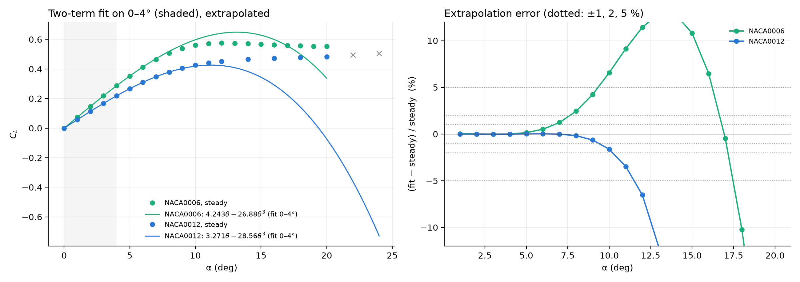
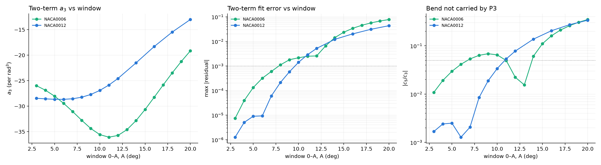

# Where does C_L = a1·θ + a3·θ³ hold? NACA0006 vs NACA0012 at Re = 500

2026-10-07. The question is how far in angle the two-term odd fit stays valid, and whether that
range depends on section thickness. A NACA0006 steady sweep was run at Re = 500, integer angles
0–20°, and compared with the existing NACA0012 Re = 500 sweep restricted to its integer angles.

## Summary

- **The thin section's two-term fit holds over a range about half as wide: 0–5° against 0–9°.**
  Each of the four tests below gives the same picture. The thinner section fails 2–4° earlier,
  depending on the test.

  | test | NACA0006 fails at | NACA0012 fails at |
  |---|---:|---:|
  | 0–4° fit extrapolated is off by > 1 % | 7° | 10° |
  | same, > 2 % | 8° | 11° |
  | same, > 5 % | 10° | 12° |
  | a3 moves > 5 % from its 0–4° value | window 0–6° | window 0–10° |
  | \|c5/c3\| > 5 % (bend P3 does not carry) | window 0–7° | window 0–11° |
  | two-term max \|residual\| > 1e-3 | window 0–8° | window 0–10° |

- **The cubic coefficient barely depends on thickness; the slope does.** On 0–4°:

  | | a1 (per rad) | a3 (per rad³) |
  |---|---:|---:|
  | NACA0006 | **4.243** | −26.9 |
  | NACA0012 | **3.271** | −28.6 |

  The thin section has a 30 % steeper slope but nearly the same θ³ term. Relative to the slope,
  its bend is therefore smaller (|a3|/a1 = 6.3 against 8.7). The shorter range is not explained by
  a bigger cubic.
- **What ends the range is the next term, and it has opposite signs for the two sections.**
  - **NACA0006:** the P5 coefficient c5 is *negative* in every window up to 12°. Lift bends
    *faster* than a cubic, so the 0–4° fit overpredicts from 5° on (+1.2 % at 7°, +6.6 % at 10°).
    Its a3 grows in magnitude from −26.9 (0–4°) to −36.1 (0–11°). C_L peaks at 12° (0.5757) and
    then falls slowly.
  - **NACA0012:** c5 turns *positive* from 7° on. Lift bends *slower* than a cubic and
    saturates, so the fit underpredicts from 8° on. Its a3 shrinks in magnitude, from −28.6 to
    −13.0 on 0–20°. C_L still rises at 20°.
  - The thin section's c5 is already 1–2 % of c3 on 0–3° and 0–4°, against 0.2 % for the
    NACA0012. Its higher-order content starts at small angle.
- **This matches the plate.** The plate (`../plate_case/analysis/LEGENDRE_FIT.md`) also has a
  negative P5, a window-dependent a3 and an early peak. Thinning the section moves the NACA0006
  partway towards that behaviour.





## Skepticism

- **These are steady (SIMPLE) solutions.** All 21 NACA0006 angles converged on the force trace,
  up to 20°. As at every Re here, that does not mean the flow is steady: the NACA0012 at Re = 500
  converges up to 20° while its measured shedding onset is 11.46°. The NACA0006's onset is
  unknown, and with an earlier knee it is probably lower. The domain question here is about the
  steady branch, which is what the fit describes.
- **The |c5/c3| test is not monotone for the NACA0006.** It dips back below 5 % on 0–11° to 0–13°
  only because c5 changes sign there (from negative to positive as the window takes in the peak).
  That is why each test reports where it *first* fails, not where it is last satisfied.
- **The thresholds (1e-3 absolute, 5 % drift, 5 % c5/c3) are conventions.** The ranking between
  the two sections does not depend on them: the NACA0006 fails first under every threshold
  tested, and the whole curves are in the figure.
- **Integer angles only.** A failure "at 7°" means somewhere in (6°, 7°].
- **No mesh study for the NACA0006.** It is the M2 recipe with the same cell counts. The sharper
  leading edge raises maximum non-orthogonality to 67.9° (64° for the 0012), and skewness is
  0.87; checkMesh passes on all 21 cases. The leading edge is where the thin section's bend
  starts, so this is the first thing to check before quoting the numbers to more than two figures.
- **The section is 6.12 % thick, not 6.00 %.** The geometry is truncated at 98 % chord and
  rescaled to unit chord, exactly as for the 0012, which comes out at 12.25 %. The trailing-edge
  gap is 0.0041c.

## Method

- **Mesh:** `meshing/mesher.py` has a new `--naca` option (default `0012`). The default reproduces
  `meshes/M2_ns160_nr180_b025.msh` byte for byte. The NACA0006 mesh is
  `meshes/M2_ns160_nr180_b025_naca0006_re500.msh`, built as
  `--naca 0006 --re 500 -r 30 --nr 180 --ns 160 --nte 32 --bump 0.25`.
- **Cases:** `NACA0006/steady_re500/steady_aoa{0..20}`, made by `make_steady.sh` (6000 iterations)
  and run by `NACA0006/steady_re500/sweep.sh`: sequential, 6 ranks, about 3.3 minutes per case.
- **Data:** `collect(500, "NACA0006/steady_re500")` (`collect()` now takes an optional folder).
  The NACA0012 uses `NACA0012/steady_re500/`, keeping integer angles only (0–12°, then 14, 16, 18, 20°).
  A window uses only the converged angles running continuously from 0° and ends on a computed
  angle.
- **Fits per window 0–A** (`analysis/fit_domain_thickness.py`):
  - odd Legendre on x = θ/A mirrored to [−1, 1], P1 up to P9, limited to 2n−1 for n nonzero
    angles;
  - the P1+P3 fit collected into a1·θ + a3·θ³, with its largest absolute and relative residual.
- **Extrapolation test:** fit on 0–4°, then find the first angle where the prediction misses by
  more than 1, 2 and 5 %.

## Files

- `analysis/figs/naca0006_domain/`:
  - `fit_domain.txt`: the full window tables and the failure angles;
  - `windows_NACA0006.csv` and `windows_NACA0012.csv`;
  - `cl_NACA0006.csv` and `cl_NACA0012.csv`, with the 0–4° prediction and its error;
  - `extrapolation.png` and `window_scan.png`.
- `NACA0006/steady_re500/run_steady.log`, and a `*.build.log` per case.

## Reproduce

```bash
PY=/home/raji/miniconda3/envs/research/bin/python
(cd meshing && $PY mesher.py ../meshes/M2_ns160_nr180_b025_naca0006_re500.msh \
    --naca 0006 --re 500 -r 30 --nr 180 --ns 160 --nte 32 --bump 0.25)
NACA0006/steady_re500/sweep.sh > NACA0006/steady_re500/run_steady.log 2>&1
python3 analysis/steady_summary.py --root NACA0006/steady_re500
(cd analysis && $PY fit_domain_thickness.py)
```
