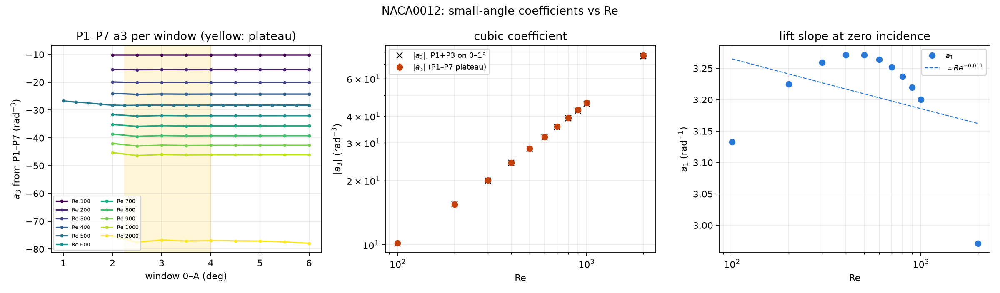
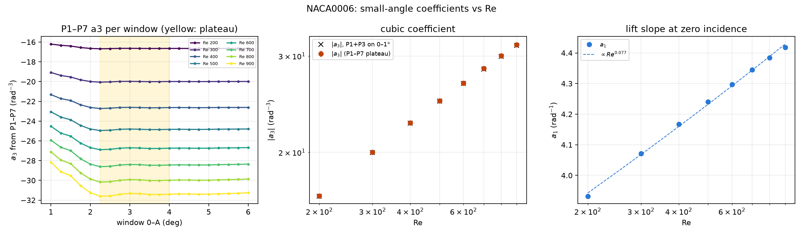

# Small-angle a1, a3 vs Re: NACA0012, NACA0006 (and the plate)

2026-10-10. This tests `instructions/Quadratic_hypothesis.md`. The method is the same as for the plate
(`../plate_case/analysis/A3_RE_SCALING.md`):
- Each window 0–A gets an odd Legendre fit.
- a3 is the mean of the P1–P7 fits over windows from 2.25 to 4°, with its scatter there as the error.
- a1, and a check value of a3, come from the two-term fit P1+P3 on 0–1°.

- Script: `a3_re_scaling_airfoil.py --shape NACA0012 --check-grid` and `--shape NACA0006`
- Outputs: `a3_re_scaling/<shape>/` (`a3_vs_re.txt`, `a3_vs_re.csv`, `a3_vs_re.png`)

## NACA0012, Re = 100–2000

- Data come from `NACA0012/steady_re{100,500,1000,2000}` and `steady_re_scaling/steady_re{200..900}`.
- All cases from 0 to 6° are converged.
- The grid is 0.5°, except at Re 500, which is 0.25°.

| Re | a1 (rad⁻¹) | a3 (rad⁻³) | a3, P1+P3 on 0–1° | local d ln\|a3\|/d ln Re |
|---:|---:|---:|---:|---:|
| 100 | 3.133 | −10.17 ± 0.01 | −10.17 | +0.60 |
| 200 | 3.225 | −15.47 ± 0.01 | −15.44 | +0.63 |
| 300 | 3.260 | −20.06 ± 0.03 | −20.01 | +0.65 |
| 400 | 3.271 | −24.28 ± 0.05 | −24.20 | +0.67 |
| 500 | 3.271 | −28.25 ± 0.05 | −28.14 | +0.69 |
| 600 | 3.264 | −32.05 ± 0.09 | −31.92 | +0.70 |
| 700 | 3.252 | −35.72 ± 0.11 | −35.56 | +0.71 |
| 800 | 3.237 | −39.28 ± 0.13 | −39.09 | +0.72 |
| 900 | 3.219 | −42.75 ± 0.14 | −42.54 | +0.72 |
| 1000 | 3.200 | −46.14 ± 0.16 | −45.91 | +0.73 |
| 2000 | 2.971 | −77.07 ± 0.36 | −76.53 | +0.74 |

**The 0.5° grid is adequate.** Refitting Re 500 on only its half-degree points gives:

| | 0.25° grid | 0.5° subset |
|---|---:|---:|
| a3 | −28.247 ± 0.046 | −28.252 ± 0.069 |
| a1 | 3.2711 | 3.2711 |

**The cubic is clean at every Re, and nothing intrudes before 6°.**
- The P1–P7 a3 is flat from 2.5 to 6° at every Re: within 0.1 % at Re 100, rising to 0.8 % at Re 1000 and 1.3 % at
  Re 2000.
- This differs from the plate, where a leading-edge bubble forms inside 6° at high Re.

**|a3| increases steadily, close to a power law.**
- A single fit over 100–2000 gives about Re^0.68.
- ln|a3| bends only slightly in ln Re (quadratic coefficient +0.03).
- The local exponent rises slowly, from 0.60 to 0.74, about 0.03 per doubling of Re.
- Locally, the scaling law holds well. Its exponent drifts slowly, so it should be quoted
  together with the Re band it was fitted over.
- Over the thesis band, Re 300–1000, the local exponent is 0.69 ± 0.04.

**a1 is nearly constant at about 3.2–3.27, about half of 2π, with a shallow maximum near Re 400–500.**

## NACA0006, Re = 200–900

- Data come from `NACA0006/steady_re500` and `NACA0006/steady_re_scaling/steady_re{200..900}`.
- The grid is 0.25° from 0 to 6°.
- All 200 cases ran the full 6000 iterations and are converged.
- The sweep ran on four machines and three OpenFOAM versions: OpenFOAM-dev, 13 and v14. At Re 500,
  the new v14 quarter-angles fall on the existing curve to 1e-6.

| Re | a1 (rad⁻¹) | a3 (rad⁻³) | a3, P1+P3 on 0–1° | local d ln\|a3\|/d ln Re | local d ln a1/d ln Re |
|---:|---:|---:|---:|---:|---:|
| 200 | 3.932 | −16.65 ± 0.01 | −16.63 | +0.45 | +0.086 |
| 300 | 4.071 | −20.00 ± 0.03 | −19.99 | +0.44 | +0.083 |
| 400 | 4.168 | −22.65 ± 0.04 | −22.61 | +0.42 | +0.079 |
| 500 | 4.240 | −24.86 ± 0.05 | −24.81 | +0.41 | +0.075 |
| 600 | 4.298 | −26.77 ± 0.07 | −26.71 | +0.40 | +0.072 |
| 700 | 4.345 | −28.47 ± 0.08 | −28.40 | +0.40 | +0.069 |
| 800 | 4.384 | −30.02 ± 0.09 | −29.93 | +0.39 | +0.067 |
| 900 | 4.418 | −31.43 ± 0.10 | −31.34 | +0.39 | +0.066 |

**Both coefficients are monotonic, and both are close to power laws.**
- |a3| goes as about Re^0.42. Its local exponent falls slowly, from 0.45 to 0.39.
- ln|a3| bends only slightly in ln Re (quadratic coefficient −0.03).
- a1 goes as about Re^0.077, with a local exponent of 0.086 → 0.066.

**The P1–P7 a3 is flat from 2.25° out to 6° at every Re**, within 0.3 % at Re 900. No leading-edge
bubble comes in before 6°.

## All three bodies

| | plate (sharp LE) | NACA0006 | NACA0012 |
|---|---|---|---|
| a1 at Re 500 (rad⁻¹) | 4.82 | 4.24 | 3.27 |
| a3 at Re 500 (rad⁻³) | −18.9 | −24.9 | −28.2 |
| a1(Re) | Re^0.10 | Re^0.077 | nearly flat; shallow maximum near Re 450 |
| a3(Re) | **non-monotonic**: maximum near Re 400–450, local exponent +0.22 → −0.48 | Re^0.42 (0.45 → 0.39) | Re^0.68 (0.60 → 0.74) |
| a3 plateau | only up to 4° at high Re (LE bubble near 6° at Re 900) | holds out to 6° | holds out to 6° |

**What the comparison shows**
- **The quadratic dC_L/dα (a1 + 3a3θ² at small θ) holds for every body at every Re tested.** a3 is
  finite, nonzero and measured to 0.1–0.5 %.
- **The two airfoils have a local scaling law, a3 ~ Re^m.**
  - The exponent drifts slowly, by about 0.03 per doubling of Re.
  - The exponent grows with thickness: about 0.42 for NACA0006 and about 0.68 for NACA0012.
- **The plate has no scaling law for a3. The most likely cause is its sharp leading edge.**
  - Its maximum in a3 coincides with the leading-edge bubble moving toward α = 0 as Re rises.
  - Neither rounded-nose airfoil shows that bubble before 6°.
  - So the plate's a3 maximum is most likely a leading-edge effect, not a thickness effect.
    This is inferred from three bodies, not tested by varying the LE shape alone.
- **The a1 exponent falls with thickness:** 0.10 for the plate, 0.077 for NACA0006, about 0 for NACA0012.
  The lift slope of the thick section is the least sensitive to Re.

## Earlier note: NACA0012 against the plate (written before NACA0006 finished)

| | plate | NACA0012 |
|---|---|---|
| a3(Re) | non-monotonic: peak near Re 400–450, local exponent +0.22 → −0.48 | monotonic: \|a3\| ~ Re^0.6–0.74 |
| a1(Re) | clean power law, Re^0.10 | nearly flat, shallow maximum near Re 450 |
| a3 plateau | holds only up to 4° at high Re (LE bubble near 6° at Re 900) | holds out to 6° at every Re |

Each body has one smooth coefficient and one that peaks, and the roles are swapped between them.
NACA0006 is thickness-intermediate, so it will show which behaviour comes from thickness and which
from the leading-edge shape. Its sweep finishes around 02:00 on 2026-10-10.
