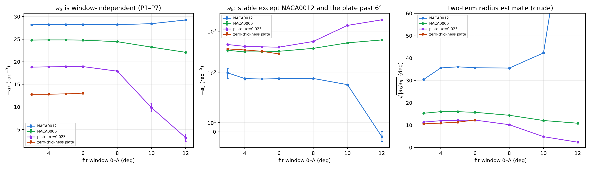
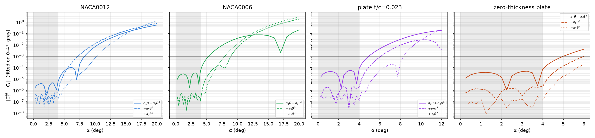

> **Correction, 20 October 2026: read section 7 first.** Every steady case behind this note ran with the
> production solver tolerances (p 1e-7, U 1e-8). Those stall 1e-7 to 2e-5 in C_L short of the fixed
> point, by an error that is smooth in α. The fits absorb it, and the window test of section 3 cannot
> see it. Re-converged ("tight") data for the zero-thickness plate at Re 500, 700 and 900 give:
> a3 within 0.1 % of the values below at Re 500 and 700 and 0.5 % at Re 900; a5 off by 3 % to over 50 %; and
> a radius of about 9.5–10.7° instead of 6–8° at Re 900. Claims that no longer hold are marked
> **[superseded, §7]** where they appear. The other three bodies have not been re-converged.

This note covers the steady (SIMPLE) lift at small angles of four bodies at Re = 500: NACA0012,
NACA0006, the 2.3 %-thick stadium plate, and the zero-thickness plate on the elliptic grid. The
zero-thickness plate's Re dependence is from the complete Re 200–900 sweep (0–6° at 0.5°).

- Script: `analysis/cubic_stress_test.py`
- Outputs: `analysis/cubic_stress_test/`
- Companion notes:
  - `zero_thickness_plate/A3_RE500.md`: the zero-thickness plate at Re 500 and its mesh history;
  - `analysis/A3_RE_SCALING.md` and `plate_case/analysis/A3_RE_SCALING.md`: a3(Re) for the other bodies.

## 1. What the claim can and cannot mean

**Any odd function that is analytic at α = 0 looks like a1·θ + a3·θ³ close enough to the origin,**
since C_L = a1θ + a3θ³ + a5θ⁵ + … . So "cubic at the origin" is not, by itself, evidence of cubic
dominance. The tests in this campaign establish three narrower things:

1. **No non-analytic term.** The deficit d = a1θ − C_L goes as θ³ as θ → 0: its local exponent
   d ln d / d ln θ tends to 3, and d/θ³ tends to a constant, −a3. A term like θ^3.4 or θ³ log θ would
   fail this. The H-type grid of the zero-thickness plate appeared to fail it (exponent 3.42). That was
   a mesh artefact; on the orthogonal grid the exponent is 3.10.
2. **a3 is finite and nonzero,** so the expansion does not start at θ⁵.
3. **a3 is robust:** it does not depend on the fit window or the fit order.

**The physically meaningful statement is the range over which the truncation holds.** For a Taylor
series that is set by the radius of convergence R: the distance from the origin to the nearest
singularity of C_L(α) in the complex α plane. Sections 4–5 estimate how the range and R behave.

## 2. Is a3 robust? Yes

Odd Legendre P1…Pk fits on windows 0–A, converted to powers of θ, with least-squares standard errors:

| body | a3, windows 3–6° | a3 drift beyond 6° | a5 (best order) |
|---|---|---|---|
| NACA0012 | −28.22 ± 0.01 | −28.0 to −29.3 at 10–12° | −72 ± 2 (P1–P7, stable 4–8°) |
| NACA0006 | −24.8 ± 0.02 | −23.2 to −24.9 at 8–12° | −300 to −320 (stable to 10° with P1–P9) |
| plate t/c 0.023 | −18.9 ± 0.02 | −18 at 8°, collapses beyond 10° | −420 to −430 (to 6°) |
| zero-thickness plate | −12.79 ± 0.02 (P1–P9) | data end at 6° | −376 to −392 (P1–P9) **[superseded, §7: −367 ± 2]** |

- **a3 is fixed to 0.1 % or better** inside each body's validity range, independent of window and of
  P1–P7 against P1–P9. *(§7: this is the spread between fits of the same production data. Against
  re-converged data the zero-thickness plate's a3 moves 0.13 % at Re 500 and 0.5 % at Re 900.)*
- **a3 and a5 have the same sign for all four bodies.**
- **Outside the validity range, the fit coefficients become window-dependent:**
  - for NACA0012 from about 10°;
  - for NACA0006 from about 8°;
  - for the plate from about 8°, where its leading-edge bubble forms (7.9–8.4° at Re 500).

## 3. Resolution: what the data can and cannot fix

**The noise floor.** Converged steady C_L is repeatable to about 1e-8. The fit residual rms is
6e-8 to 3e-7 on windows up to 6°, which sets the effective noise. **[superseded, §7]** The 1e-8 is the
repeatability of a stalled state, not its accuracy: the production runs stop 1e-7 to 2e-5 from the
fixed point, by an amount that is smooth in α and is not part of the rms.

**Other error sources:**

- *Mesh error (zero-thickness plate):* about 1e-4 in C_L at 6°, smooth in α and mostly a slope change
  (E560 against E800: ΔC_L = +0.0026θ − 0.083θ³). It moves a3 by 0.65 % and a1 by 0.05 %.
- *Cross-version error:* OpenFOAM dev, 13 and v14 agree to about 4e-7.

**Test.** For each coefficient, compare its window-to-window spread (windows 4–6°) with its standard
error:

- spread ≈ se means **noise-limited**: the coefficient is resolved;
- spread much larger than se means content beyond the fit order leaks into it: **window-dependent**.

| body | fit | a3 | a5 | a7 | a9 |
|---|---|---|---|---|---|
| NACA0012 | P1–P7 | 0.65 | 0.97 | 1.5 | — |
| NACA0006 | P1–P9 | 1.5 | 2.7 | 4.7 | 7.5 |
| plate t/c 0.023 | P1–P9 | 1.6 | 2.7 | 4.1 | 5.9 |
| zero-thickness plate | P1–P9 | 1.4 | 2.4 | 2.8 | 7.0 |
| zero-thickness plate | P1–P7 | 17 | 20 | 16 | — |

(Values are spread / standard error.)

- **Resolved:** a1, a3 and a5 for every body, and a7 for NACA0012 (+3500 ± 200).
- **Not resolved:** a7 for the three thinner bodies, and a9 for any body. These shift by several
  standard errors between windows.
- **The zero-thickness plate needs P1–P9 even on 0–6°.** With P1–P7 its a3 and a5 drift by 17–20
  standard errors. It has more high-order content than the thick bodies, consistent with its smaller R
  (section 5).
- **What limits us is range and truncation, not noise.** The data end at 6° (zero-thickness plate),
  12° (plate) and 20° (airfoils). Beyond those ranges the higher-order content cannot be separated from
  the coefficients being sought. **[superseded, §7]** A third limit was missed: the solver-tolerance bias.
  It is smooth in α, so this test passes it. The Re 700 a5 of section 5 passed (spread/se ≈ 4) at −405,
  against −376 from re-converged data.

## 4. How much does a5 help? Extrapolating truncations fitted on 0–4°

First angle where the fit misses the data by more than 1e-3:

| body | a1θ + a3θ³ | + a5θ⁵ | + a7θ⁷ |
|---|---|---|---|
| NACA0012 | 8.5° | 7.5° | 10.5° |
| NACA0006 | 5.5° | 9° | 8° |
| plate t/c 0.023 | 5° | 6.25° | 8.5° |
| zero-thickness plate | 5.25° | > 6° (end of data) | > 6° (end of data) |

- **The cubic truncation alone holds to 5–5.5° for the thin bodies, and to 8.5° for NACA0012.**
- **Adding θ⁵ helps the thin bodies.**
  - It extends NACA0006 to 9° and the plate to 6.25°, and keeps the zero-thickness plate within 1e-3
    to the end of its data.
  - It does not help NACA0012, whose a5 is small (−72) and comparable to its θ⁷ contribution.
- **Adding θ⁷ helps NACA0012 (10.5°) and the plate (8.5°),** but not NACA0006.
- **Every truncation fails somewhere around 8–10.5°.** For the plate that is the leading-edge bubble
  range.

## 5. Radius of convergence and singularities

**Two-term estimate R ≈ sqrt|a3/a5|** (crude: the asymptotic ratio test needs four or more reliable
coefficients):

| body, Re 500 | sqrt\|a3/a5\| |
|---|---|
| NACA0012 | 30–36° |
| NACA0006 | about 16° |
| plate t/c 0.023 | about 12° |
| zero-thickness plate | about 10.5° |

**The radius shrinks as the body thins,** which is the same ordering as the extrapolation ranges.

**The zero-thickness plate, against Re** (elliptic grid, P1–P9 on 0–6°, complete Re only):

| Re | a1 | a3 | a5 | sqrt\|a3/a5\| |
|---|---|---|---|---|
| 200 | 4.531 | −14.63 | −143 | 18.3° |
| 300 | 4.717 | −14.61 | −247 | 13.9° |
| 400 | 4.842 | −13.85 | −317 | 12.0° |
| 500 | 4.935 | −12.79 | −380 | 10.5° |
| 600 | 5.007 | −11.67 | −418 | 9.6° |
| 700 | 5.066 | −10.52 | −482 | 8.5° |
| 800 | 5.115 | −9.38 | −452 to −569 | 7.4–8.2° |
| 900 | 5.156 | −8.30 | −485 to −805 | 5.8–7.5° |

a1 is the Richardson limit and a3 the P1–P7 plateau over 2.25–4° (plateau spread 0.005–0.045, at most
0.5 %).

**[superseded, §7]** The a5 and radius columns of this table, and the four bullets below, are production
data. Re-converged at Re 500 / 700 / 900: a5 = −367 / −376 / −313, radius about 10.7° / 9.5° / 9.4°.

- **At Re 800 and 900, a5 is not resolved from 0–6°.** The P1–P9 a5 moves with the window by far more
  than its standard error: Re 900 gives −485 ± 28 (window 0–5°), −583 ± 32 (0–5.5°) and −805 ± 68 (0–6°).
  The ranges in the table are the 0–5° and 0–6° values. This is what a radius of 6–8° predicts: the 6°
  window reaches the radius itself, so the series cannot be truncated there.
  - a3 is not affected, since its windows end at 4°.
  - At Re 700 and below, P1–P9 a5 is stable on 0–5 and 0–5.5° (Re 700: −405 ± 1 and −409 ± 1).
- **Re 800 and 900 at 4–6° were run to 12000 iterations,** because they were still creeping at 6000. The
  extension moved C_L by at most 1.6e-4 (Re 900, 6°), and a3 by 0.2–0.3 % (−9.41 → −9.38, −8.32 → −8.30).
  The remaining drift, extrapolated geometrically, is below 6e-6.
- **The cubic range shrinks steadily with Re, roughly as Re^−0.63** (Re 200–800; −0.69 including the
  Re 900 6°-window value). |a5| grows by 3–5× from Re 200 to 900.
- **a3 falls almost linearly above Re 400,** by 1.06–1.15 per 100 in Re. Between Re 200 and 300 it is flat.
- **This would fit a singularity that moves toward α = 0 as Re rises,** as the plate's leading-edge
  bubble formation angle does (7.9° at Re 500, 5.75° at Re 900). That is a hypothesis, not a result.

**Which singularities are candidates:**

- **Hopf bifurcation (shedding onset): not a candidate.** The steady branch continues analytically
  through a Hopf point as an unstable solution. SIMPLE computes it beyond onset (NACA0012: α_c = 11.46°
  at Re 500), so onset does not limit R.
- **Fold (saddle-node) of the steady branch: a genuine singularity.** It gives C_L ~ √(α_s − α), a
  square-root branch point on the real axis, with coefficients of one sign.
  - Same-sign a3 and a5 are consistent with a real singularity.
  - But NACA0006 has converged steady solutions to 20°, beyond its estimate of about 16°, so a real fold
    below 20° is ruled out there. Its nearest singularity is probably complex.
- **Leading-edge bubble formation: not a singularity in itself.** The steady solution stays analytic
  in α while the linearised problem is invertible (implicit function theorem). A topological change in
  the streamlines is not a bifurcation.
  - A sharp but smooth transition does, however, come with complex singularities close to the real
    axis.
  - A complex pair approaching the real axis near α_f would match the truncation failures at 8–10° and
    an R that shrinks with Re.
  - **Not established.**

## 6. What is established, and what is not

**Established:**

- All four bodies are analytic at the origin with a finite, nonzero a3; there is no non-analytic term.
- a3 is robust to 0.1 % for each body, and to about 1 % including mesh error for the zero-thickness
  plate. *(§7: 0.5 % at Re 900 against re-converged data; still inside the 1 %.)*
- a5 is measurable for all bodies, a7 for NACA0012 only. *(§7: the production a5 values are biased;
  re-converged, the zero-thickness plate's a5 is resolved at Re 500–900, and a7 borderline.)*
- The truncation range and the two-term radius shrink with thickness. For the zero-thickness plate
  they also shrink with Re. *(§7: over Re 500–900 the re-converged radius shrinks only from about
  10.7° to 9.4°.)*

**Not established:**

- The location and type of the singularity that limits R.
- Whether it is tied to leading-edge bubble formation.
- Anything that needs a7 and beyond for the thin bodies.

**Next:**

1. Padé approximants in θ² on the fitted data, to locate the complex singularities directly.
2. Extend the zero-thickness plate to 12° (Re 500 at least), to fix a5 and a7.
3. Extend the zero-thickness plate beyond 6° at Re 800–900 (or refine to 0.25°), so that a5 can be
   resolved where the radius is smallest.

## 7. Correction (20 October 2026): the production data carry a solver-tolerance bias

**What happened.** Every steady case in this note used the production linear-solver settings: p
`tolerance 1e-7`, U `tolerance 1e-8`, both with `relTol 0.01`. A solve stops at whichever comes
first, r < tolerance or r < relTol·r₀. Once the initial residual r₀ falls below tolerance/relTol =
1e-5, the absolute tolerance is the limit that binds. Late in a run, U solves then do 0 iterations and p
solves do 0–2, so each SIMPLE iteration removes almost nothing. SIMPLE contracts the error by only
ρ ≈ 0.998 per iteration, and the run stalls at a distance of about step/(1 − ρ) from the fixed point:
**1e-7 to 2e-5 in C_L, growing with α.** The 1e-8 "repeatability" of section 3 is the repeatability of
that stall.

**The fix.** Each case was continued with `fvSolution.tight` (tolerance 1e-12, same relTol 0.01) for
3000 or more further iterations, so the tolerance never binds. An angle is counted as usable when its
last 500 iterations moved C_L by at most 3e-9 and the geometrically extrapolated remainder is also
within 3e-9.

- Scripts: `zero_thickness_plate/tighten_case.sh` and `zero_thickness_plate/tight/`; analysis in
  `analysis/tight_compare.py` (`python analysis/tight_compare.py 500 700 900 --drop`, research env).
- Outputs: `analysis/tight_compare/`.
- Same elliptic grid as sections 2–5.

**How the bias entered the fits.** It depends on whether the angles were run the same way:

- **Run the same way** (Re 500, and Re 700 on the 0.5° grid): the error is smooth in α (Re 700:
  −6e-7 at 2–2.5°, +3.5e-6 at 4°, +8e-6 at 4.5°). A smooth error is absorbed into the coefficients, so
  every window shifts together and the spread/se test of section 3 passes. Re 700's production a5
  (−405 ± 1, −409 ± 1) was stable across windows and 8 % wrong.
- **Run two ways** (the 0.25° quarter angles, seeded separately, mixed with the 0.5° angles at Re 700
  and 900): neighbouring angles stall on opposite sides of the fixed point. Fits of the mixed
  production data have rms 4e-7, and a5 changes sign between windows.
- **A window-stability test cannot detect an error that all the data share.** Only re-converged data
  can.

**Re-converged coefficients, zero-thickness plate** (odd Legendre fits, converted to θ powers; the
production values of section 5 in brackets):

| Re | usable angles | a1 | a3 | a5 | a7 | sqrt\|a3/a5\| | sqrt\|a5/a7\| |
|---|---|---|---|---|---|---|---|
| 500 | 17: 0.25–4.25° at 0.25° | 4.93491 | −12.806 (−12.79) | −367 ± 2 (−380) | ≈ −9500 ± 1000 | 10.7° | 10–11° |
| 700 | 15: 0.25–3.75° at 0.25° | 5.06595 | −10.528 (−10.52) | −376 ± 4 (−405 to −482) | ≈ −1.2e4 to −1.6e4 | 9.5° | 8.6–10.4° |
| 900 | 12: 0.25–4°, with gaps | 5.15642 | −8.342 (−8.30) | −313 ± 2 (−485 to −805) | ≈ −1.1e4 to −1.25e4 | 9.4° | 9.0–9.6° |

- **Re 500:** P1–P9 a5 settles at −370.5, −368.2, −367.4 on windows 0–3, 0–3.5 and 0–4°; P1–P11 gives
  −364 and −367.
- **Re 700:** P1–P9 a5 is flat over 0–2 to 0–3.5° (−379, −374, −378, −380). P1–P11 gives about −373. The
  difference between the fit orders is most of the error bar, and a7 differs by about 30 % between them.
- **Re 900 needs P1–P11 on 0–4°:** P1–P9 rms rises from 2e-9 to 1e-8 there. P1–P11 keeps rms at 1.6e-9
  and a5 at −314, −313, −313, −312 over windows 0–2.5 to 0–4°.
- **a9 and a11 are not resolved** at any Re.

**What this changes:**

1. **a3:** within 0.13 % (Re 500) and 0.08 % (Re 700) of section 5, and 0.5 % at Re 900. The 0.1 %
   claim fails only at Re 900, and stays inside the 1 % that includes mesh error. a3 still falls
   almost linearly: by 1.14 per 100 in Re over 500–700 and 1.09 over 700–900.
2. **a5:** the production values are biased by 3 % (Re 500) to 55 % or more (Re 900). Re-converged,
   **|a5| does not grow with Re over 500–900** (−367, −376, −313). The "|a5| grows 3–5×" and the
   Re^−0.63 shrinkage of section 5 rest on production a5 and are withdrawn for Re 500–900. Re 200–400,
   600 and 800 have not been re-converged.
3. **Radius:** the two ratio estimates sqrt|a3/a5| and sqrt|a5/a7| now agree at each Re. The radius
   falls only from about 10.7° (Re 500) to 9.4° (Re 900), not to 6–8°. It no longer tracks the plate's
   leading-edge bubble formation angle (5.75° at Re 900).
4. **Sign pattern (hypothesis, not result):** at Re 900 every fitted coefficient from a3 to a11 is
   negative. Coefficients of one sign point to a nearest singularity on the real α axis, here near
   9–11°. For a fold this is the √(α_s − α) branch point of section 5.

**Not yet done:**

- **Twelve angles are still not converged** after the tight phase: Re 500 at 4.5–5°; Re 700 at 4–4.5°;
  Re 900 at 0.75, 3, 3.25, 3.75, 4.25 and 4.5°. Above about 3°, 3000 tight iterations are not enough.
  Finishing them extends the windows to 4.5–5°, which is what a7 needs.
- **NACA0012, NACA0006 and the 2.3 % plate** ran with the same production tolerances. Their a5 and a7
  in sections 2–4 are unverified, and their a3 should be checked the same way.
- The a5 mesh sensitivity (E560 against E800) is still unmeasured.
