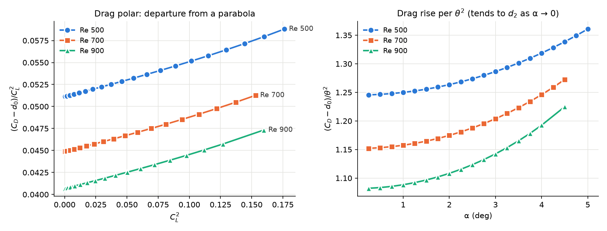

> **Correction, 20 October 2026: read section 7 first.** Every steady case behind this note ran with the
> production solver tolerances (p 1e-7, U 1e-8). Those stall 1e-7 to 2e-5 in C_L short of the fixed
> point, by an error that is smooth in α. The fits absorb it, and the window test of section 3 cannot
> see it. Re-converged ("tight") data for the zero-thickness plate at Re 500, 700 and 900 give:
> a3 within 0.1 % of the values below at Re 500 and 700 and 0.5 % at Re 900; a5 off by 3 % to over 50 %; and
> a radius of about 9.5–10.7° instead of 6–8° at Re 900. Claims that no longer hold are marked
> **[superseded, §7]** where they appear. The other three bodies have not been re-converged.

This note covers the steady (SIMPLE) lift at small angles of four bodies at Re = 500: NACA0012,
NACA0006, the 2.3 %-thick stadium plate, and the zero-thickness plate on the elliptic grid. The
zero-thickness plate's Re dependence is from the complete Re 200–900 sweep (0–6° at 0.5°).

- Script: `analysis/cubic_stress_test.py`
- Outputs: `analysis/cubic_stress_test/`
- Companion notes:
  - `zero_thickness_plate/A3_RE500.md`: the zero-thickness plate at Re 500 and its mesh history;
  - `analysis/A3_RE_SCALING.md` and `plate_case/analysis/A3_RE_SCALING.md`: a3(Re) for the other bodies.

## 1. What the claim can and cannot mean

**Any odd function that is analytic at α = 0 looks like a1·θ + a3·θ³ close enough to the origin,**
since C_L = a1θ + a3θ³ + a5θ⁵ + … . So "cubic at the origin" is not, by itself, evidence of cubic
dominance. The tests in this campaign establish three narrower things:

1. **No non-analytic term.** The deficit d = a1θ − C_L goes as θ³ as θ → 0: its local exponent
   d ln d / d ln θ tends to 3, and d/θ³ tends to a constant, −a3. A term like θ^3.4 or θ³ log θ would
   fail this. The H-type grid of the zero-thickness plate appeared to fail it (exponent 3.42). That was
   a mesh artefact; on the orthogonal grid the exponent is 3.10.
2. **a3 is finite and nonzero,** so the expansion does not start at θ⁵.
3. **a3 is robust:** it does not depend on the fit window or the fit order.

**The physically meaningful statement is the range over which the truncation holds.** For a Taylor
series that is set by the radius of convergence R: the distance from the origin to the nearest
singularity of C_L(α) in the complex α plane. Sections 4–5 estimate how the range and R behave.

## 2. Is a3 robust? Yes

Odd Legendre P1…Pk fits on windows 0–A, converted to powers of θ, with least-squares standard errors:

| body | a3, windows 3–6° | a3 drift beyond 6° | a5 (best order) |
|---|---|---|---|
| NACA0012 | −28.22 ± 0.01 | −28.0 to −29.3 at 10–12° | −72 ± 2 (P1–P7, stable 4–8°) |
| NACA0006 | −24.8 ± 0.02 | −23.2 to −24.9 at 8–12° | −300 to −320 (stable to 10° with P1–P9) |
| plate t/c 0.023 | −18.9 ± 0.02 | −18 at 8°, collapses beyond 10° | −420 to −430 (to 6°) |
| zero-thickness plate | −12.79 ± 0.02 (P1–P9) | data end at 6° | −376 to −392 (P1–P9) **[superseded, §7: −367 ± 2]** |

- **a3 is fixed to 0.1 % or better** inside each body's validity range, independent of window and of
  P1–P7 against P1–P9. *(§7: this is the spread between fits of the same production data. Against
  re-converged data the zero-thickness plate's a3 moves 0.13 % at Re 500 and 0.5 % at Re 900.)*
- **a3 and a5 have the same sign for all four bodies.**
- **Outside the validity range, the fit coefficients become window-dependent:**
  - for NACA0012 from about 10°;
  - for NACA0006 from about 8°;
  - for the plate from about 8°, where its leading-edge bubble forms (7.9–8.4° at Re 500).

## 3. Resolution: what the data can and cannot fix

**The noise floor.** Converged steady C_L is repeatable to about 1e-8. The fit residual rms is
6e-8 to 3e-7 on windows up to 6°, which sets the effective noise. **[superseded, §7]** The 1e-8 is the
repeatability of a stalled state, not its accuracy: the production runs stop 1e-7 to 2e-5 from the
fixed point, by an amount that is smooth in α and is not part of the rms.

**Other error sources:**

- *Mesh error (zero-thickness plate):* about 1e-4 in C_L at 6°, smooth in α and mostly a slope change
  (E560 against E800: ΔC_L = +0.0026θ − 0.083θ³). It moves a3 by 0.65 % and a1 by 0.05 %.
- *Cross-version error:* OpenFOAM dev, 13 and v14 agree to about 4e-7.

**Test.** For each coefficient, compare its window-to-window spread (windows 4–6°) with its standard
error:

- spread ≈ se means **noise-limited**: the coefficient is resolved;
- spread much larger than se means content beyond the fit order leaks into it: **window-dependent**.

| body | fit | a3 | a5 | a7 | a9 |
|---|---|---|---|---|---|
| NACA0012 | P1–P7 | 0.65 | 0.97 | 1.5 | — |
| NACA0006 | P1–P9 | 1.5 | 2.7 | 4.7 | 7.5 |
| plate t/c 0.023 | P1–P9 | 1.6 | 2.7 | 4.1 | 5.9 |
| zero-thickness plate | P1–P9 | 1.4 | 2.4 | 2.8 | 7.0 |
| zero-thickness plate | P1–P7 | 17 | 20 | 16 | — |

(Values are spread / standard error.)

- **Resolved:** a1, a3 and a5 for every body, and a7 for NACA0012 (+3500 ± 200).
- **Not resolved:** a7 for the three thinner bodies, and a9 for any body. These shift by several
  standard errors between windows.
- **The zero-thickness plate needs P1–P9 even on 0–6°.** With P1–P7 its a3 and a5 drift by 17–20
  standard errors. It has more high-order content than the thick bodies, consistent with its smaller R
  (section 5).
- **What limits us is range and truncation, not noise.** The data end at 6° (zero-thickness plate),
  12° (plate) and 20° (airfoils). Beyond those ranges the higher-order content cannot be separated from
  the coefficients being sought. **[superseded, §7]** A third limit was missed: the solver-tolerance bias.
  It is smooth in α, so this test passes it. The Re 700 a5 of section 5 passed (spread/se ≈ 4) at −405,
  against −376 from re-converged data.

## 4. How much does a5 help? Extrapolating truncations fitted on 0–4°

First angle where the fit misses the data by more than 1e-3:

| body | a1θ + a3θ³ | + a5θ⁵ | + a7θ⁷ |
|---|---|---|---|
| NACA0012 | 8.5° | 7.5° | 10.5° |
| NACA0006 | 5.5° | 9° | 8° |
| plate t/c 0.023 | 5° | 6.25° | 8.5° |
| zero-thickness plate | 5.25° | > 6° (end of data) | > 6° (end of data) |

- **The cubic truncation alone holds to 5–5.5° for the thin bodies, and to 8.5° for NACA0012.**
- **Adding θ⁵ helps the thin bodies.**
  - It extends NACA0006 to 9° and the plate to 6.25°, and keeps the zero-thickness plate within 1e-3
    to the end of its data.
  - It does not help NACA0012, whose a5 is small (−72) and comparable to its θ⁷ contribution.
- **Adding θ⁷ helps NACA0012 (10.5°) and the plate (8.5°),** but not NACA0006.
- **Every truncation fails somewhere around 8–10.5°.** For the plate that is the leading-edge bubble
  range.

## 5. Radius of convergence and singularities

**Two-term estimate R ≈ sqrt|a3/a5|** (crude: the asymptotic ratio test needs four or more reliable
coefficients):

| body, Re 500 | sqrt\|a3/a5\| |
|---|---|
| NACA0012 | 30–36° |
| NACA0006 | about 16° |
| plate t/c 0.023 | about 12° |
| zero-thickness plate | about 10.5° |

**The radius shrinks as the body thins,** which is the same ordering as the extrapolation ranges.

**The zero-thickness plate, against Re** (elliptic grid, P1–P9 on 0–6°, complete Re only):

| Re | a1 | a3 | a5 | sqrt\|a3/a5\| |
|---|---|---|---|---|
| 200 | 4.531 | −14.63 | −143 | 18.3° |
| 300 | 4.717 | −14.61 | −247 | 13.9° |
| 400 | 4.842 | −13.85 | −317 | 12.0° |
| 500 | 4.935 | −12.79 | −380 | 10.5° |
| 600 | 5.007 | −11.67 | −418 | 9.6° |
| 700 | 5.066 | −10.52 | −482 | 8.5° |
| 800 | 5.115 | −9.38 | −452 to −569 | 7.4–8.2° |
| 900 | 5.156 | −8.30 | −485 to −805 | 5.8–7.5° |

a1 is the Richardson limit and a3 the P1–P7 plateau over 2.25–4° (plateau spread 0.005–0.045, at most
0.5 %).

**[superseded, §7]** The a5 and radius columns of this table, and the four bullets below, are production
data. Re-converged at Re 500 / 700 / 900: a5 = −367 / −376 / −313, radius about 10.7° / 9.5° / 9.4°.

- **At Re 800 and 900, a5 is not resolved from 0–6°.** The P1–P9 a5 moves with the window by far more
  than its standard error: Re 900 gives −485 ± 28 (window 0–5°), −583 ± 32 (0–5.5°) and −805 ± 68 (0–6°).
  The ranges in the table are the 0–5° and 0–6° values. This is what a radius of 6–8° predicts: the 6°
  window reaches the radius itself, so the series cannot be truncated there.
  - a3 is not affected, since its windows end at 4°.
  - At Re 700 and below, P1–P9 a5 is stable on 0–5 and 0–5.5° (Re 700: −405 ± 1 and −409 ± 1).
- **Re 800 and 900 at 4–6° were run to 12000 iterations,** because they were still creeping at 6000. The
  extension moved C_L by at most 1.6e-4 (Re 900, 6°), and a3 by 0.2–0.3 % (−9.41 → −9.38, −8.32 → −8.30).
  The remaining drift, extrapolated geometrically, is below 6e-6.
- **The cubic range shrinks steadily with Re, roughly as Re^−0.63** (Re 200–800; −0.69 including the
  Re 900 6°-window value). |a5| grows by 3–5× from Re 200 to 900.
- **a3 falls almost linearly above Re 400,** by 1.06–1.15 per 100 in Re. Between Re 200 and 300 it is flat.
- **This would fit a singularity that moves toward α = 0 as Re rises,** as the plate's leading-edge
  bubble formation angle does (7.9° at Re 500, 5.75° at Re 900). That is a hypothesis, not a result.

**Which singularities are candidates:**

- **Hopf bifurcation (shedding onset): not a candidate.** The steady branch continues analytically
  through a Hopf point as an unstable solution. SIMPLE computes it beyond onset (NACA0012: α_c = 11.46°
  at Re 500), so onset does not limit R.
- **Fold (saddle-node) of the steady branch: a genuine singularity.** It gives C_L ~ √(α_s − α), a
  square-root branch point on the real axis, with coefficients of one sign.
  - Same-sign a3 and a5 are consistent with a real singularity.
  - But NACA0006 has converged steady solutions to 20°, beyond its estimate of about 16°, so a real fold
    below 20° is ruled out there. Its nearest singularity is probably complex.
- **Leading-edge bubble formation: not a singularity in itself.** The steady solution stays analytic
  in α while the linearised problem is invertible (implicit function theorem). A topological change in
  the streamlines is not a bifurcation.
  - A sharp but smooth transition does, however, come with complex singularities close to the real
    axis.
  - A complex pair approaching the real axis near α_f would match the truncation failures at 8–10° and
    an R that shrinks with Re.
  - **Not established.**

## 6. What is established, and what is not

**Established:**

- All four bodies are analytic at the origin with a finite, nonzero a3; there is no non-analytic term.
- a3 is robust to 0.1 % for each body, and to about 1 % including mesh error for the zero-thickness
  plate. *(§7: 0.5 % at Re 900 against re-converged data; still inside the 1 %.)*
- a5 is measurable for all bodies, a7 for NACA0012 only. *(§7: the production a5 values are biased;
  re-converged, the zero-thickness plate's a5 is resolved at Re 500–900, and a7 borderline.)*
- The truncation range and the two-term radius shrink with thickness. For the zero-thickness plate
  they also shrink with Re. *(§7: over Re 500–900 the re-converged radius shrinks only from about
  10.7° to 9.4°.)*

**Not established:**

- The location and type of the singularity that limits R.
- Whether it is tied to leading-edge bubble formation.
- Anything that needs a7 and beyond for the thin bodies.

**Next:**

1. Padé approximants in θ² on the fitted data, to locate the complex singularities directly.
2. Extend the zero-thickness plate to 12° (Re 500 at least), to fix a5 and a7.
3. Extend the zero-thickness plate beyond 6° at Re 800–900 (or refine to 0.25°), so that a5 can be
   resolved where the radius is smallest.

## 7. Correction (20 October 2026): the production data carry a solver-tolerance bias

**What happened.** Every steady case in this note used the production linear-solver settings: p
`tolerance 1e-7`, U `tolerance 1e-8`, both with `relTol 0.01`. A solve stops at whichever comes
first, r < tolerance or r < relTol·r₀. Once the initial residual r₀ falls below tolerance/relTol =
1e-5, the absolute tolerance is the limit that binds. Late in a run, U solves then do 0 iterations and p
solves do 0–2, so each SIMPLE iteration removes almost nothing. SIMPLE contracts the error by only
ρ ≈ 0.998 per iteration, and the run stalls at a distance of about step/(1 − ρ) from the fixed point:
**1e-7 to 2e-5 in C_L, growing with α.** The 1e-8 "repeatability" of section 3 is the repeatability of
that stall.

**The fix.** Each case was continued with `fvSolution.tight` (tolerance 1e-12, same relTol 0.01) for
3000 or more further iterations, so the tolerance never binds. An angle is counted as usable when its
last 500 iterations moved C_L by at most 3e-9 and the geometrically extrapolated remainder is also
within 3e-9.

- Scripts: `zero_thickness_plate/tighten_case.sh` and `zero_thickness_plate/tight/`; analysis in
  `analysis/tight_compare.py` (`python analysis/tight_compare.py 500 700 900 --drop`, research env).
- Outputs: `analysis/tight_compare/`.
- Same elliptic grid as sections 2–5.

**How the bias entered the fits.** It depends on whether the angles were run the same way:

- **Run the same way** (Re 500, and Re 700 on the 0.5° grid): the error is smooth in α (Re 700:
  −6e-7 at 2–2.5°, +3.5e-6 at 4°, +8e-6 at 4.5°). A smooth error is absorbed into the coefficients, so
  every window shifts together and the spread/se test of section 3 passes. Re 700's production a5
  (−405 ± 1, −409 ± 1) was stable across windows and 8 % wrong.
- **Run two ways** (the 0.25° quarter angles, seeded separately, mixed with the 0.5° angles at Re 700
  and 900): neighbouring angles stall on opposite sides of the fixed point. Fits of the mixed
  production data have rms 4e-7, and a5 changes sign between windows.
- **A window-stability test cannot detect an error that all the data share.** Only re-converged data
  can.

**Re-converged coefficients, zero-thickness plate** (odd Legendre fits, converted to θ powers; the
production values of section 5 in brackets):

| Re | usable angles | a1 | a3 | a5 | a7 | sqrt\|a3/a5\| | sqrt\|a5/a7\| |
|---|---|---|---|---|---|---|---|
| 500 | 17: 0.25–4.25° at 0.25° | 4.93491 | −12.806 (−12.79) | −367 ± 2 (−380) | ≈ −9500 ± 1000 | 10.7° | 10–11° |
| 700 | 15: 0.25–3.75° at 0.25° | 5.06595 | −10.528 (−10.52) | −376 ± 4 (−405 to −482) | ≈ −1.2e4 to −1.6e4 | 9.5° | 8.6–10.4° |
| 900 | 12: 0.25–4°, with gaps | 5.15642 | −8.342 (−8.30) | −313 ± 2 (−485 to −805) | ≈ −1.1e4 to −1.25e4 | 9.4° | 9.0–9.6° |

- **Re 500:** P1–P9 a5 settles at −370.5, −368.2, −367.4 on windows 0–3, 0–3.5 and 0–4°; P1–P11 gives
  −364 and −367.
- **Re 700:** P1–P9 a5 is flat over 0–2 to 0–3.5° (−379, −374, −378, −380). P1–P11 gives about −373. The
  difference between the fit orders is most of the error bar, and a7 differs by about 30 % between them.
- **Re 900 needs P1–P11 on 0–4°:** P1–P9 rms rises from 2e-9 to 1e-8 there. P1–P11 keeps rms at 1.6e-9
  and a5 at −314, −313, −313, −312 over windows 0–2.5 to 0–4°.
- **a9 and a11 are not resolved** at any Re.

**What this changes:**

1. **a3:** within 0.13 % (Re 500) and 0.08 % (Re 700) of section 5, and 0.5 % at Re 900. The 0.1 %
   claim fails only at Re 900, and stays inside the 1 % that includes mesh error. a3 still falls
   almost linearly: by 1.14 per 100 in Re over 500–700 and 1.09 over 700–900.
2. **a5:** the production values are biased by 3 % (Re 500) to 55 % or more (Re 900). Re-converged,
   **|a5| does not grow with Re over 500–900** (−367, −376, −313). The "|a5| grows 3–5×" and the
   Re^−0.63 shrinkage of section 5 rest on production a5 and are withdrawn for Re 500–900. Re 200–400,
   600 and 800 have not been re-converged.
3. **Radius:** the two ratio estimates sqrt|a3/a5| and sqrt|a5/a7| now agree at each Re. The radius
   falls only from about 10.7° (Re 500) to 9.4° (Re 900), not to 6–8°. It no longer tracks the plate's
   leading-edge bubble formation angle (5.75° at Re 900).
4. **Sign pattern (hypothesis, not result):** at Re 900 every fitted coefficient from a3 to a11 is
   negative. Coefficients of one sign point to a nearest singularity on the real α axis, here near
   9–11°. For a fold this is the √(α_s − α) branch point of section 5.

**Not yet done:**

- **Twelve angles are still not converged** after the tight phase: Re 500 at 4.5–5°; Re 700 at 4–4.5°;
  Re 900 at 0.75, 3, 3.25, 3.75, 4.25 and 4.5°. Above about 3°, 3000 tight iterations are not enough.
  Finishing them extends the windows to 4.5–5°, which is what a7 needs.
- **NACA0012, NACA0006 and the 2.3 % plate** ran with the same production tolerances. Their a5 and a7
  in sections 2–4 are unverified, and their a3 should be checked the same way.
- The a5 mesh sensitivity (E560 against E800) is still unmeasured.

## 8. Locating the singularity: Padé and AAA at Re 500 (20 October 2026)

C_L is odd, so C_L = θ·g(z) with z = θ². A pole of a rational approximant of g at z_p puts a
singularity at θ = ±√z_p: on the real α axis if z_p > 0, on the imaginary axis if z_p < 0, a complex
pair otherwise. Data: the 17 re-converged angles at Re 500 (0.25–4.25°, section 7), and the production
sweep to 6° as a check.

- Script: `analysis/pade_singularity.py` (`python analysis/pade_singularity.py 500 [--prod]`, research
  env).
- Outputs: `analysis/pade_singularity/`.

**Three routes:**

- **A. Classical Padé of the fitted Taylor coefficients** (`scipy.interpolate.pade`): fails. Its poles
  jump between 4 and 26°, and it produces doublets on the imaginary axis. Padé of a series amplifies
  errors in the highest coefficients, and a9 and a11 are uncertain by 20–100 %. Kept as a record.
- **B. Rational least squares** C_L = θ·P_L(z)/Q_M(z), fitted directly to C_L, with z scaled to [0, 1]
  and Sanathanan–Koerner reweighting. Orders [1/1] to [4/3], windows 0–3° to 0–4.25°, and refits with
  noise of the fit's own rms (about 8e-9, the scatter between angles).
- **C. AAA** (`scipy.interpolate.AAA`): barycentric rational approximation with its own doublet
  handling, independent of B's basis. Fitted to C_L(θ) mirrored to ±θ and to g(z), over tolerances
  1e-5 to 1e-8.

**Froissart doublets** are poles cancelled by a zero on top of them: noise-fitting artefacts. A pole
is counted as genuine only if it has no zero within 1 % (in z), its residue is not negligible, and it
stays put across orders, windows and noise. In the [3/2] fit, for example:

| | pole at 3.11° | pole at 10.85° |
|---|---|---|
| nearest zero | 3.11°: on top of it | 10.36°: 9 % away in z |
| residue | 1.2e-8 | 3.1 |
| contribution to C_L at the data edge | 1.9e-9 (below the noise) | 4.1e-2 (most of the nonlinearity) |
| across fit orders | 2.5–6.3°, moves | 10.71–10.85°, fixed |

**Result: one real-axis pole near 10.8°, with a zero just before it.**

| route | data | genuine nearest pole | zero before it |
|---|---|---|---|
| B | tight, windows 0–3.5° to 0–4.25°, all orders | 10.71–11.00° | 10.26–10.37° |
| B | production, windows to 0–6° | 10.71–11.31° | 10.25–10.71° |
| C | tight, loose tolerance (2–4 terms) | 10.74–10.76° | 10.28–10.30° |
| C | tight, tight tolerance (interpolates the noise) | 10.74–10.82°, plus doublets of residue 1e-12 to 1e-7 | — |
| C | production, same angles | 10.68–10.79° | 10.24–10.31° |

- **No complex or imaginary-axis pole** appears nearer than this, in any route.
- **Extra degrees of freedom go into doublets** inside the data range. The data resolve one singular
  feature and no more.
- **Zero before pole.** That is how a Padé approximant represents a branch point with a positive
  exponent: the [1/1] Padé of √(1 − x), branch point at 1, has its zero at 4/3 and its pole at 4. For
  1/√(1 − x) the order is reversed. The pattern fits a square-root branch point, such as a fold
  C_L ~ √(α_s − α), at or a little below about 10.3°. One pole–zero pair cannot fix the exponent.

**Limits:**

1. **The low orders are not new information.** The [1/1] pole is √|a3/a5| and the [2/1] pole is
   √|a5/a7|. The higher orders and AAA show that the feature persists, but they add no second one.
2. **Rational fits do not extrapolate better.** Fitted on 0–4.25°, polynomials to θ⁹ and θ¹¹ predict
   the production C_L at 4.5–6° to within 7e-6, which is inside the production bias. The rational fits
   miss by 5e-5 to 1e-4 at 6°. On 0–6°, one-pole fits leave rms 3e-7 to 3e-6.
3. **10.8° is 2.5 times beyond the data.** The location is robust across methods. That C_L really has a
   singularity there is not established.

**The direct test is running** (`zero_thickness_plate/fold/`): steady runs at Re 500 on the same E800
grid at 7–12°, in two chains.

- **Ascending, this machine:** 7, 8, 9, 9.5, 10, 10.5, 11, 12°, each seeded from the angle below,
  starting from the converged 6° case.
- **Descending, cfd-test:** 12° from a cold start, then 11, 10.5, 10, 9.5, 9°, each seeded from above.
- **How to read it:** a fold would show as SIMPLE losing convergence, C_L steepening like a square root,
  or the two chains disagreeing over a band of angles (hysteresis). If the chains agree and C_L stays
  smooth through 10–11°, the singularity is not a real-axis fold.

## 9. Drag: the even half of the same expansion (20 October 2026)

For a symmetric body C_D is even in α: C_D = d0 + d2 θ² + d4 θ⁴ + …. It is a functional of the same
steady solution as C_L, so its singularities lie in the same set. Body axes split the force into a
normal part C_N = C_L cos θ + C_D sin θ (odd) and an axial part C_A = C_D cos θ − C_L sin θ (even).

- To second order these are tied exactly: **n1 = a1 + d0** and **d2 = n1 + A2 − A0/2**. Both checks
  close to 1e-9 and 1e-5 respectively.
- The **net suction fraction η = −A2/n1** compares the θ² axial force with the normal-force slope. For
  the potential flat plate (C_A = −2πθ², C_N = 2πθ) η = 1 and there is no drag rise. In viscous flow A2
  also contains the change of skin friction with α, so η is net of it.

Script: `analysis/drag_even_fit.py` (`python analysis/drag_even_fit.py 500 700 900 [--prod]`, and
`--bodies` for the four bodies on production data, research env). Outputs, including the figure
`drag.png`: `analysis/drag_even_fit/`.

**C_D converges far better than C_L.**

- The tight-run tails move by 1e-11 to 5e-10 per 500 iterations, and every tight angle is usable for
  C_D, including 4.5–5° where C_L is not.
- The even fits leave rms 2e-10 to 7e-10, against about 8e-9 for C_L.
- Production C_D is biased by 1e-9 to 8e-8 below 4.25° (C_L: 1e-7 to 4e-6). Fitted to the zero-thickness
  plate, it gives d0 and d2 to 3e-5 and d4 to 0.3–0.6 %, but not d6.
- **The α = 0 point** comes from the production 0° case and has to pass the same tail test. At Re 500 and
  700 it does, with about 2e-9 remaining. At Re 900 it stopped at 6000 iterations, still moving 2.3e-7 per
  500, and is dropped. The fit's d0 = 0.1026093 then matches that case's extrapolated end value
  (0.1026094).

**Coefficients, zero-thickness plate (tight data, P0–P10 even fits, windows 0–4° to 0–5°):**

| Re | d0 | d2 | d4 | d6 | √\|d2/d4\| | η | d2/a1² |
|---|---|---|---|---|---|---|---|
| 500 | 0.1421739 | 1.24534 | 14.86 | 32–34 | 16.6° | 0.741 | 0.0511 |
| 700 | 0.1178845 | 1.15176 | 18.65 | 102–106 | 14.2° | 0.766 | 0.0449 |
| 900 | 0.1026093 | 1.08174 | 21.53 | 159–167 | 12.8° | 0.785 | 0.0407 |

- **d0, d2 and d4 are resolved** (spread within a few standard errors). d6 is borderline: it depends on
  the window by about 5 %.
- **Every coefficient is positive.** d4 and d6 grow with Re.
- **d0 exceeds the two-sided Blasius value 2 × 1.328/√Re by 20 % (Re 500) to 16 % (Re 900).** The excess
  shrinks with Re, as finite-Re edge corrections should.
- **η rises with Re (0.74 → 0.79):** more of the potential-flow suction survives as viscosity weakens.
- **(C_D − d0)/C_L² grows almost linearly in C_L²** (figure, left), so the drag polar departs from a
  parabola from the start.

**The four bodies at Re 500 (production data, P0–P8 and P1–P9, windows 0–4° and 0–6°):**

| body | d0 | d2 | d4 | η | d2/a1² |
|---|---|---|---|---|---|
| NACA0012 | 0.17413 | 1.087 | 2.5–2.6 | 0.659 | 0.102 |
| NACA0006 | 0.15694 | 1.144 | 6.6 | 0.722 | 0.064 |
| plate t/c 0.023 | 0.15351 | 1.253 | 10.3–10.4 | 0.733 | 0.054 |
| zero-thickness plate | 0.14217 | 1.245 | 14.6–14.9 | 0.741 | 0.051 |

From thick to thin, d0 falls, d4 grows about 6 times, η rises and the polar ratio halves.

**Singularities (routes B and C of section 8, the doublet tests applied):**

| Re | from C_L | from C_N | from C_A | from C_D |
|---|---|---|---|---|
| 500 | 10.7–10.9°, zero before | 10.7–10.9°, zero before | 11.5° (AAA 11.46°), zero at 11.0° before it | none consistent |
| 700 | 8.6–10.3°, unsettled | 7.7–10.2°, unsettled | 9.1–9.2° (AAA 9.06°), zero at 9.5° after it | none consistent |
| 900 | 7.0–10.4°, unsettled | unsettled | 7.3–7.9° (AAA 7.93°), zero at 7.4–8.6° after it | none consistent |

- **C_D shows no consistent singularity at any Re.** Its poles scatter between 8 and 37°, some on the
  imaginary axis, and AAA's are doublets. **C_A shows one in every order and in AAA**, moving toward
  α = 0 as Re rises: 11.5°, 9.2°, about 7.6°.
- **A possible reading (hypothesis):** C_D = C_N sin θ + C_A cos θ. If near the singularity the singular
  parts satisfy sing(C_A) ≈ −tan θ_s · sing(C_N), they cancel in C_D and survive in C_L and C_N. The
  critical mode would then push the force nearly perpendicular to the freestream. Comparing the
  residues of C_A and C_N at a common pole would test this; it has not been done.
- **The C_L singularity is robust only at Re 500.** At 700 and 900 its location moves with the fit order
  (7–10°), and the pole–zero pairs nearly cancel. That marks a weak feature, not a measured one. The
  Re 500 fold test (section 8) is still the direct check.

## 10. Is the singular force along the lift? A residue test at Re 500 (20 October 2026)

Section 9 left a hypothesis: C_D shows no consistent singularity because the singular parts of C_N and
C_A cancel in it. Equivalently, near θ_s the singular part of the force points along the lift.

**Method.** Separate Padé fits put the poles in different places, so their residues cannot be compared.
Both forces are therefore fitted with **one shared denominator**: C_L = θ·P_L(z)/Q(z) and
C_D = P_D(z)/Q(z). Each block is weighted by its own noise (σ_L = 8.1e-9, σ_D = 5.7e-10). Partial
fractions then give both residues at the same pole, r_L and r_D. Their ratio r_D/r_L fixes the
direction of the singular force from the lift axis.

- The hypothesis predicts r_D/r_L ≈ 0.
- A singular force along the body normal would give tan θ_s ≈ 0.19.
- A random direction gives order 1.

Script: `analysis/residue_test.py` (`python analysis/residue_test.py 500`). Output:
`analysis/residue_test/`.

**Three routes:**

1. **Shared-denominator fits,** orders [1–3/1–3], windows 0–3.5°, 0–4° and 0–4.25°, 200 noise refits each.
2. **Model comparison:** with Q fixed, C_D refitted with and without a pole at z_s.
3. **Square-root model,** fitted directly: C_L/θ = poly₂(z) + B_L√(1 − z/z_s) with z_s scanned, then
   C_D = poly₃(z) + B_D√(1 − z/z_s) with the same z_s. The ratio is B_D/(θ_s B_L).

**Calibration, done twice.**

- **The first synthetic set failed.** Its singularity was about 4 times weaker than the data's (a5 −99
  against −367). The pole came out at 14°, and nonzero ratios were recovered about 30 % low.
- **The second uses route 3's fit of the real data as the truth.** That fit reaches the noise floor, with
  rms_L = 8.7e-9. B_D was then reset to give known ratios.

| truth | 0 | 0.01 | 0.05 | 0.19 | 1.0 |
|---|---|---|---|---|---|
| [3/2] recovers | +0.002 | +0.011 | +0.044 | +0.157 | +0.69 |
| [3/3] recovers | −0.042 | +0.016 | +0.013 | +0.234 | — |

[3/2] is reliable for small ratios and reads 20–30 % low for large ones. [3/3] cannot tell 0 from 0.05.
The criterion fixed in advance ("every order within max(0.05, 20 %)") fails, and so does the
discrimination check added afterwards. Both fail because of [3/3].

**Results:**

- **Route 1.** Only [3/2] and [3/3] reach the noise floor; the lower orders leave C_L rms 5e-8 to 3e-5.
  - [3/2] puts the shared pole at 9.6–11.0° with r_D/r_L = −0.002, +0.003, +0.007 over the three
    windows, and P_D itself vanishes at the pole.
  - [3/3] gives +0.04, and −0.07 (pole found in only 60 % of the noise refits).
- **Route 2.** Forbidding the pole outright costs a factor of about 66 in C_D rms. So C_D's singular
  part is small, but not exactly zero.
- **Route 3.** Branch point at **θ_s = 8.92°**, below the Padé pole near 10.8°, as section 8's
  zero-before-pole pattern predicted. The ratio is **B_D/(θ_s B_L) = +0.0049**.

**Verdicts under the stated rules:**

| rule | outcome | why |
|---|---|---|
| fixed in advance: all real-pole fits | REJECTED | driven by low orders that do not fit the data (rms 10²–10⁴ × the noise) |
| amended after seeing the data: only fits at the noise floor | INCONCLUSIVE | driven by [3/3], which the calibration shows cannot discriminate |

**Reading.** The two routes that are calibrated or model-based, [3/2] and the square-root fit, agree:
**C_D's singular amplitude is about 0.5 % of C_L's.** The singular force then lies about 0.3° from the
lift axis, against 10.8° for the body normal and order 1 for a random direction. That is what the
hypothesis predicts, with a small nonzero drag component, as route 2 requires. It is not "confirmed"
under either stated rule. **The square-root fit also gives a new estimate of the fold location, 8.9°,**
which the running chains test directly: both include 9°.
