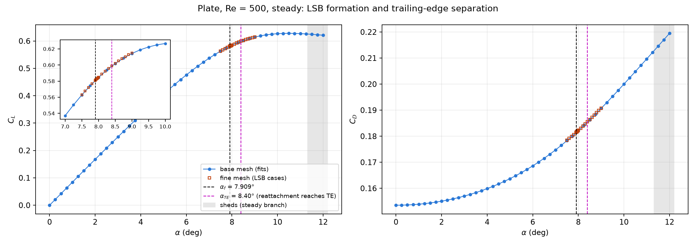
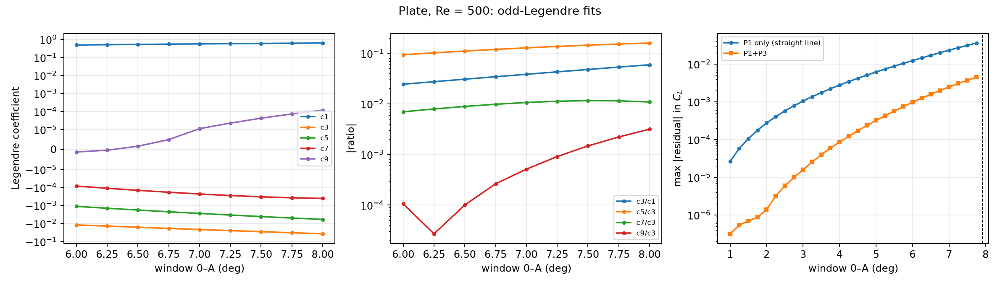
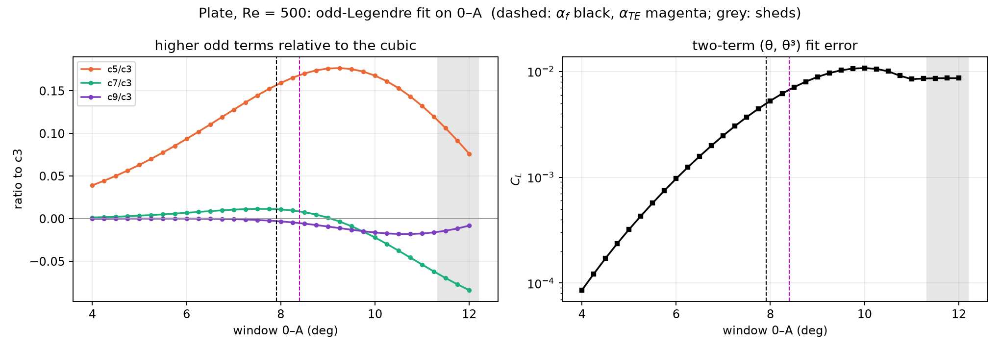
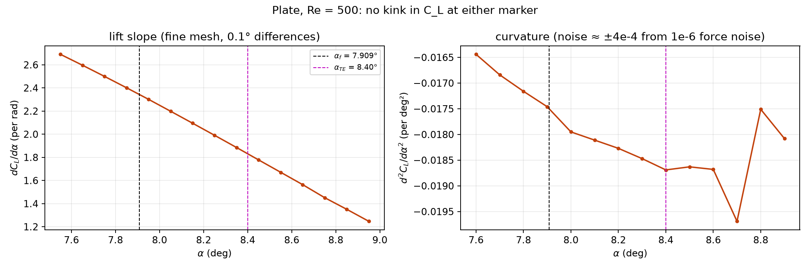
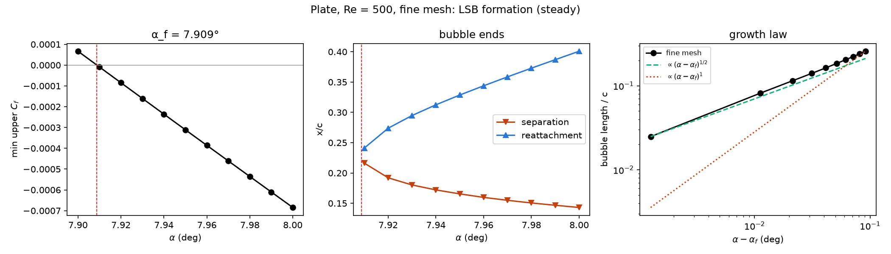
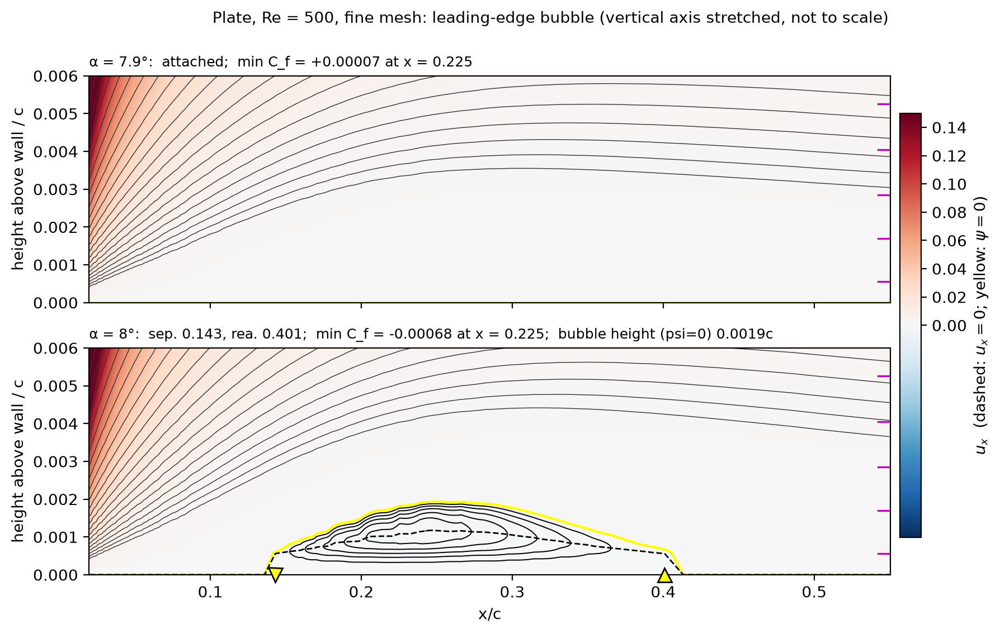
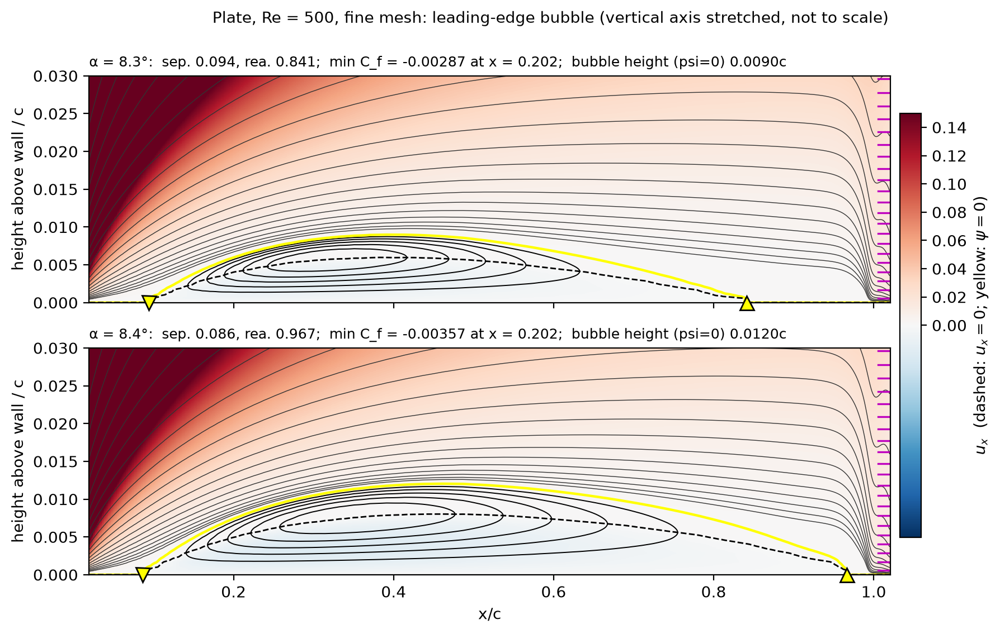
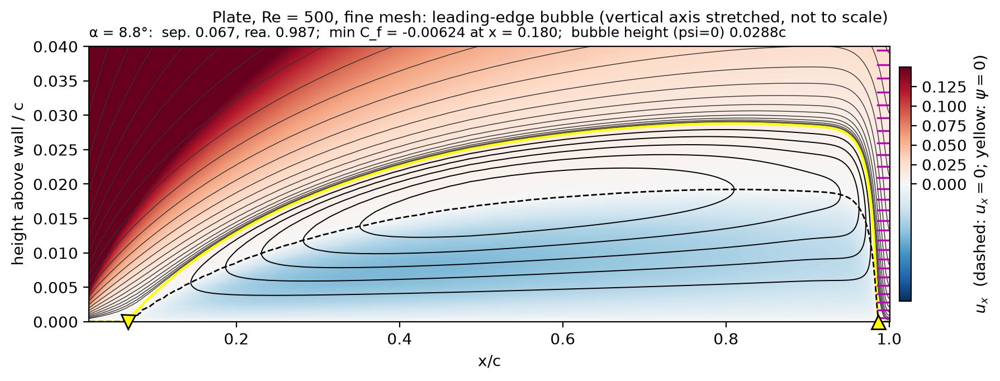
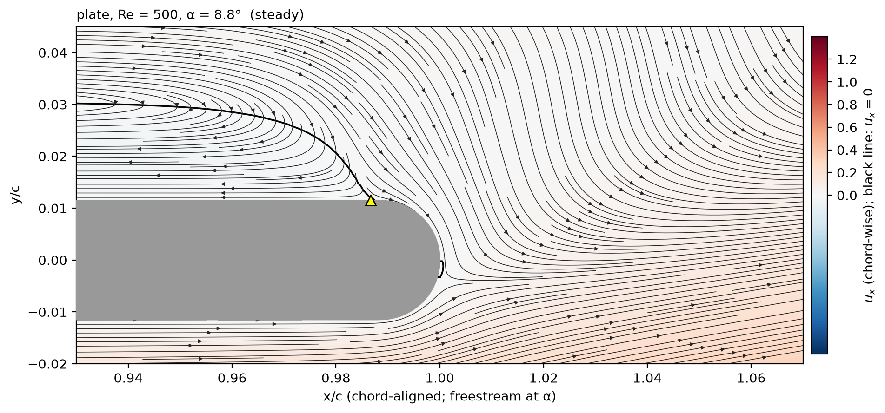

# LSB hypothesis test: plate, Re = 500 (steady)

2026-10-09. This note answers the Test section of `instructions/lsb_hypothesis.md` for the thick
flat plate (t/c = 0.023). The script is `hypothesis_test.py`, and its outputs are in `figs/hypothesis/`.

> ## ⚠ How "trailing-edge separation" (α_TE) is defined here
>
> **In this note, "trailing-edge separation" means the angle at which the leading-edge bubble's
> reattachment point reaches the trailing edge: α_TE = 8.40°, bracketed in (8.3°, 8.4°].** It is
> a definition chosen for this plate (decision of 2026-10-09). It is **not** the usual meaning:
>
> - **The plate's trailing edge never separates on its own.** Below α_f the upper surface is
>   attached all the way to the trailing edge. No separation starts at the trailing edge and
>   moves forward.
> - **The bubble does not burst or open into the wake** anywhere in the computed range (up to
>   9.0°). Above 8.4° it covers the whole upper surface but stays closed. Its rear stagnation
>   point sits in the corner where the flat surface meets the rounded trailing edge
>   (x_flat = 0.9892c). Reattachment goes 0.967, 0.979, 0.983, 0.985, 0.987, 0.988, 0.989 from
>   8.4° to 9.0°. No reversed flow appears in the near wake.
> - **The value 8.40° is an extrapolation.** From 8.0° to 8.3° the reattachment point moves
>   downstream linearly, at 1.466c per degree. That straight line reaches x_flat at 8.405°.
>   Above that the reattachment point can only creep into the corner.
>
> Every "α_TE" below, in the figures and in the PDF, carries this meaning. A different definition
> would move α_TE. Reversed flow in the near wake, for example, has not happened by 9.0°, and
> shedding begins at about 11.3°. Such a change would also change the fits labelled (A) and (B).

## Verdict

| claim | verdict on the plate |
|---|---|
| 1. Lift is mostly linear before the LSB forms | **False.** Lift curves from the smallest angles. A straight line misses by 0.4 % on 0–3°, 2.6 % on 0–6° and 6.3 % on 0–7.75°. All of these ranges are below α_f, where there is no separation anywhere. |
| 2. Once the LSB forms, cubic terms explain the curvature well | **Not supported.** Every measure of how cubic-like the curve is (c3/c1, c5/c3, the two-term error, a3) changes smoothly through α_f, with no change of trend. Inside [α_f, α_TE] the local curvature is −0.0182 per deg², twice the −0.0094 per deg² that the best two-term fit implies there. |
| 3. Once trailing-edge separation happens, the cubic term loses dominance | **Partly.** Beyond α_TE the lift slope keeps falling to zero (peak C_L 0.628 near 10.5°). The odd series needs c7 and c9: c7/c3 changes sign at about 9° and reaches −0.08 by 12°. But this happens gradually and later, from about 9.5°. Nothing changes at α_TE itself. |

**What the bubble does to the lift curve:**
- **No kink at either marker.** The lift slope falls on a straight line straight through α_f and
  α_TE (fine mesh, 0.1° spacing; `slope_curvature_markers.png`).
- **The curvature effects are tiny.** The curvature steepens by about 5e-4 per deg² at α_f and
  stops growing after α_TE. Both are about the size of the force noise (±4e-4).
- **Visible only in the fourth difference.** The fourth difference of C_L on the 0.25° grid rises
  from about 1e-6 below 7° to 1.8e-5 at 7.75–8°. This is the only clear sign of the bubble in the
  forces.



## Data

- **Plate geometry:** thickness t/c = 0.023 (2.3 % of chord). The section is a stadium: a flat plate with semicircular leading and trailing edges of radius 0.0115c, overall length c = 1. (`plate_mesher.py --th 0.023`, the default, after the Eldredge & Wang plate in `plate_v2.geo`.)
- **Lift curve:**
  - Production mesh (`plate_case/re500`, 63k cells), every 0.25° from 0° to 12°, 49 angles.
  - All 49 meet the sweep's force-trace convergence test (`plate_case/re500/RESULTS.md`).
  - The 0.25° points were shared out over three machines: this machine (OpenFOAM-dev), banana-cfd
    (OpenFOAM 13: 0.25, 0.75, 1.25, 1.75°) and cfd-test (OpenFOAM v14: 2.25–5.75°).
  - The second differences show no step between versions, and the fourth differences are within
    ±6e-6. That bounds any offset between versions at about 4e-7 in C_L.
- **Markers and the (B) fit:** fine mesh (`plate_fine_re500/`, 91k cells, h1 = 0.025/√Re). It has
  0.1° spacing over 7.5–9.0° and 0.01° spacing over 7.90–8.00°.
- **On the forces, the two meshes agree to better than 0.1 %** (`plate_case/mesh_conv_re500/RESULTS.md`).
- **Formation angle:** α_f = 7.9087° on the fine mesh and 7.892° on the production mesh.
- **Above about 11.33° these are steady solutions of a flow that actually sheds**
  (`plate_case/unsteady_re500/ONSET.md`). They are shaded grey in every figure.

## Markers

| marker | value | how it is found |
|---|---|---|
| α_f (bubble forms) | **7.9087°** (±0.0003° from iteration error) | Smallest upper-surface C_f on 0.02 < x < 0.9 crosses zero. C_f,min = −0.00752 (α − 7.9087), maximum residual 1.2e-6. The first zero is at x = 0.225. |
| **α_TE ("trailing-edge separation", defined above)** | **8.40°**, bracket (8.3, 8.4] | The bubble's reattachment reaches x_flat = 0.9892 (linear extrapolation of 8.0–8.3°) |
| shedding onset | about 11.33° | Unsteady runs (plate_case/unsteady_re500) |

## (C) Odd Legendre fit on 0–A, A = 6–8° in 0.25° steps

The method is the same as `plate_case/analysis/legendre_plate.py`. Angles are mapped to
x = α/A and mirrored onto [−1, 1], and the fit uses P1, P3, P5, P7 and P9 with no constant term.
All 0.25° points with α ≤ A are used, so n ranges from 24 to 32 nonzero angles. The last three
columns are the two-term P1 + P3 fit, rewritten as C_L = a1·θ + a3·θ³ (θ in radians).

| A (°) | n | c1 | c3 | c5 | c7 | c9 | c3/c1 | c5/c3 | a1 (/rad) | a3 (/rad³) | max error, P1+P3 |
|---:|---:|---:|---:|---:|---:|---:|---:|---:|---:|---:|---:|
| 6.0 | 24 | 0.48921 | −0.01196 | −0.001120 | −8.32e-05 | −1.26e-06 | −0.0244 | 0.094 | 4.845 | −26.40 | 9.7e-04 |
| 6.25 | 25 | 0.50781 | −0.01393 | −0.001421 | −1.11e-04 | −3.77e-07 | −0.0274 | 0.102 | 4.849 | −27.22 | 1.2e-03 |
| 6.5 | 26 | 0.52612 | −0.01617 | −0.001788 | −1.44e-04 | 1.62e-06 | −0.0307 | 0.111 | 4.854 | −28.11 | 1.6e-03 |
| 6.75 | 27 | 0.54410 | −0.01871 | −0.002231 | −1.84e-04 | 4.92e-06 | −0.0344 | 0.119 | 4.859 | −29.06 | 2.0e-03 |
| 7.0 | 28 | 0.56172 | −0.02159 | −0.002761 | −2.30e-04 | 1.11e-05 | −0.0384 | 0.128 | 4.866 | −30.08 | 2.5e-03 |
| 7.25 | 29 | 0.57894 | −0.02484 | −0.003389 | −2.80e-04 | 2.26e-05 | −0.0429 | 0.136 | 4.873 | −31.17 | 3.0e-03 |
| 7.5 | 30 | 0.59574 | −0.02850 | −0.004122 | −3.30e-04 | 4.20e-05 | −0.0478 | 0.145 | 4.882 | −32.31 | 3.7e-03 |
| 7.75 | 31 | 0.61207 | −0.03260 | −0.004966 | −3.75e-04 | 7.23e-05 | −0.0533 | 0.152 | 4.891 | −33.51 | 4.5e-03 |
| 8.0 | 32 | 0.62789 | −0.03719 | −0.005926 | −4.05e-04 | 1.17e-04 | −0.0592 | 0.159 | 4.901 | −34.75 | 5.3e-03 |

- **c5 is about 9–16 % of c3 across the whole range**, and its share grows steadily from window
  to window. The two-term fit's error grows 5× between 0–6° and 0–8°, and a3 drifts from −26.4 to
  −34.8. This is the window-dependence found earlier for the plate. It does not change trend at
  the 0–7.75° and 0–8° windows, the ones that straddle α_f.
- **c9 is noise-level up to 6.5°**, then grows from 1e-5 to 1.2e-4 over the 7–8° windows. That is
  the only coefficient that responds near α_f, and it is the Legendre counterpart of the
  fourth-difference rise noted above.



## Claim 1: is lift linear before the LSB forms?

For each window, compare a straight line (P1 only) with the two-term fit (P1 + P3). Every window
ends below α_f = 7.91°, so there is no separation anywhere on the surface.

| window | C_L at its end | max straight-line error | as % of C_L | max P1+P3 error | a3 (/rad³) |
|---|---:|---:|---:|---:|---:|
| 0–1° | 0.0841 | 2.6e-05 | 0.03 % | 3.2e-07 | −18.9 |
| 0–2° | 0.1676 | 2.7e-04 | 0.16 % | 1.4e-06 | −19.5 |
| 0–3° | 0.2497 | 1.0e-03 | 0.42 % | 1.6e-05 | −20.4 |
| 0–4° | 0.3296 | 2.8e-03 | 0.84 % | 8.6e-05 | −21.8 |
| 0–5° | 0.4057 | 6.2e-03 | 1.52 % | 3.2e-04 | −23.7 |
| 0–6° | 0.4760 | 1.2e-02 | 2.59 % | 9.7e-04 | −26.4 |
| 0–7° | 0.5371 | 2.3e-02 | 4.33 % | 2.5e-03 | −30.1 |
| 0–7.75° | 0.5742 | 3.6e-02 | 6.28 % | 4.5e-03 | −33.5 |

- **There is a cubic term from the start.** a3 → −18.9 /rad³ on the smallest windows, so lift
  curves with no bubble and no separation at all.
- **"Mostly linear" holds only up to about 2–3°**, where the straight line is within 0.2–0.4 %.
- **On 0–6° the cubic is already needed:** the straight line misses by 2.6 %, against 0.2 % for
  P1 + P3. This bending comes from the attached boundary layer at Re = 500, not from a bubble.

## (B) Legendre fit between α_f and α_TE (7.909–8.40°)

Fine mesh, 14 angles: 7.91 to 7.99 in 0.01° steps, and 8.0, 8.1, 8.2, 8.3, 8.4. The window is
mapped onto [−1, 1] and the fit uses every degree, odd and even. The production mesh has only
two angles here (8.0 and 8.25), too few to fit.

| degree | c0 | c1 | c2 | c3 | RMSE | max error |
|---:|---:|---:|---:|---:|---:|---:|
| 1 | 0.590382 | 0.009031 | | | 1.6e-04 | 3.3e-04 |
| **2** | 0.590486 | 0.008960 | −0.000366 | | 6.7e-07 | 1.3e-06 |
| 3 | 0.590487 | 0.008961 | −0.000366 | −0.000002 | 1.0e-07 | 1.9e-07 |

- **Slope** (straight-line least squares): **0.0368 per degree = 2.11 per rad**. At mid-window the
  degree-2 fit gives 2.09 per rad.
- **Curvature: −0.0182 per deg².** The curve is a parabola to within its noise (1e-6). The local
  cubic term is 0.5 % of the quadratic.
- **Compared with the global odd two-term fit on 0–8.25°** (a1 = 4.913 /rad, a3 = −36.0 /rad³):
  at mid-window that fit implies a slope of 2.72 per rad and a curvature of −0.0094 per deg². So
  the actual curve is about 23 % less steep there and bends about twice as hard. Within the
  bubble range, a θ + θ³ law does **not** describe the curvature well (claim 2).

## (A) Legendre fit beyond α_TE: slope after "trailing-edge separation" (α_TE as defined above)

Production mesh, 8.5–12° (15 angles, every 0.25°), window mapped onto [−1, 1].

| fit | linear slope | slope at mid-window | curvature | max error |
|---|---:|---:|---:|---:|
| 8.5–12°, degree 1 | **0.0046 /deg = 0.261 /rad** | | | 1.2e-02 |
| 8.5–12°, degree 2 | 0.261 /rad | 0.261 /rad | −0.0106 /deg² | 1.7e-03 |
| 8.5–12°, degree 3 | 0.261 /rad | 0.142 /rad | −0.0106 /deg² | 3.7e-05 |
| 8.5–11.25° (below shedding), degree 2 | **0.0082 /deg = 0.470 /rad** | 0.470 /rad | −0.0129 /deg² | 7.9e-04 |

- **The reported slope after "trailing-edge separation" is 0.26 per rad over 8.5–12°**, or
  0.47 per rad if the shedding range is left out.
- **That compares with 2.1 per rad between α_f and α_TE, and 4.83 per rad at small angles.**
  These are averages over windows. The pointwise slope falls continuously, from 1.83 per rad at
  8.4° to 1.25 per rad at 8.95° (fine mesh).
- **Beyond α_TE the curve is shaped by its maximum** (C_L 0.6279 at 10.5°). The quadratic
  (even) term dominates the local fit, which a purely odd series centred at 0° can reproduce only
  with growing c7 and c9.





## The LSB in pictures (fine mesh)

The bubble forms at α_f = 7.909° as a single point at x = 0.225, with length ∝ (α − α_f)^0.53–0.61
near formation. It grows downstream until its reattachment reaches the trailing edge at α_TE
≈ 8.40°. Further detail is in `README.md`.











## Caveats

1. **The meaning of α_TE was chosen, not observed** (see the box at the top). Fits (A) and (B)
   depend on it. Under a wake-recirculation definition, α_TE would be above 9° and probably close
   to the shedding onset.
2. **Bubble resolution.** At formation the reversed flow occupies only the first cell row
   (0.00056c from the wall). α_f barely depends on the mesh (7.892° vs 7.909°), but bubble
   lengths near formation are uncertain at the 10 % level.
3. **Steady branch above 11.33°.** The 8.5–12° fit includes four steady solutions of a flow that
   actually sheds. The 8.5–11.25° row leaves them out.
4. **One Reynolds number, one section.** The hypothesis is about the trend from NACA0012 to
   NACA0006 to the plate, and only the plate is tested here. The NACA0012 has no leading-edge
   bubble at Re = 500, yet its two-term fit holds to 9° (`../STEADY_NACA0006_DOMAIN.md`). That
   already suggests the bubble is not what sets the cubic.
5. **Mixed solver versions** in the 0.25° grid. They are bounded at about 4e-7 in C_L (see Data).

## Files and reproduce

```bash
PY=/home/raji/miniconda3/envs/research/bin/python
(cd ../../plate_case && bash run_sweep.sh --re 500 --ranks 6 --step 0.25)   # 0.25-deg lift curve
$PY formation_fine.py      # alpha_f, growth law
$PY hypothesis_test.py     # markers, fits (A) (B) (C), claim-1 table, figures
```

- `figs/hypothesis/` holds the tables and figures:
  - `markers.txt`, `fits.txt` and `run_output.txt`;
  - `odd_windows_6to8.csv`, `odd_windows_4to12.csv` and `claim1_windows.csv`;
  - `fine_separation.csv`, `fine_slope.csv` and `fine_curvature.csv`;
  - four `*.png` figures.
- **PDF:** `../reports/lsb_hypothesis/lsb_hypothesis.pdf`.
