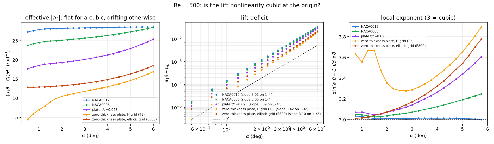

# Zero-thickness plate, Re = 500: cubic at the origin, a3 = −12.79

2026-10-19. This tests `instructions/Quadratic_hypothesis.md`: does C_L = a1·θ + a3·θ³ hold at small angles?
The zero-thickness plate is added to NACA0012, NACA0006 and the 2.3 %-thick plate. Each body uses one mesh
for all its angles, with the angle set by rotating the freestream.

**Result: yes.** On an orthogonal (elliptic-coordinate) grid, the zero-thickness plate is cubic at the
origin like the other three bodies.
- a3 = −12.79 rad⁻³ and a1 = 4.935 rad⁻¹ (79 % of 2π), on mesh E800.
  - ±0.02 is only the fit scatter.
  - **Measured mesh sensitivity (E560 → E800): a3 −12.71 → −12.79 (0.65 %); a1 changes by 0.05 %.**
  - Refinement makes a3 more negative. The mesh-converged value is estimated at −12.87 to −12.98
    (assuming second- or first-order convergence), so a3 ≈ −12.8 to −13.0, about 1 % uncertainty.
    See Mesh.
- |a3| grows steadily with thickness and a1 falls.
- An earlier finding on an H-type grid, that the deficit goes as θ^3.4 and a3 is not defined, was a mesh
  artefact. See the end of this note.

- Data: `ell_re500/steady_aoa<A>`, 0–6° every 0.25° (25 cases), all converged on the force trace:
  - 0, 0.25, 0.5 and 1°: 10000 iterations;
  - 6°: 12000;
  - all others: 6000, warm-started from a converged neighbour.
  - Cold and warm starts gave identical C_L and C_D at 0.5°.
- Mesh: `meshes/ell_nnu800_nmu210_re500.msh` (E800, 168k cells, `ell_mesher.py`).
  - Max non-orthogonality 4.5°, max skewness 3.8, `checkMesh` OK.
  - First cell normal to the plate at mid-chord: h1 = 2.24e-3.
  - Tip cell 1.5e-5c.
  - Outer ellipse at 30c, centred at mid-chord.
- Machines: this machine (OpenFOAM-dev), machine B and cfd-test (v14).
- Script: `a3_zero_thickness.py --mesh ell`. Outputs: `a3_re500_ell/`.

## Result

**Fit coefficients** (same method as the other bodies: P1–P7 averaged over windows 2.25–4°, and P1+P3 on
0–1° as a check):

| body | t/c | a1 (rad⁻¹) | a3 (rad⁻³) | a3, P1+P3 on 0–1° |
|---|---:|---:|---:|---:|
| zero-thickness plate | 0 | **4.935** | **−12.79 ± 0.02** | −12.96 |
| plate (stadium, semicircular edges r = 0.0115c) | 0.023 | 4.825 | −18.89 ± 0.05 | −18.86 |
| NACA0006 | 0.06 | 4.240 | −24.86 ± 0.05 | −24.81 |
| NACA0012 | 0.12 | 3.271 | −28.25 ± 0.05 | −28.14 |

**The cubic test.** It removes the linear part, d = a1·θ − C_L.
- a1 is the Richardson limit of C_L/θ, using 0.25° and 0.5°.
- If the nonlinearity is cubic at the origin, d/θ³ tends to a constant (−a3) and the local exponent of d
  tends to 3.

| body | exponent of d, 1–4° | d/θ³ at 0.5° | 1° | 2° | 4° | 6° |
|---|---:|---:|---:|---:|---:|---:|
| NACA0012 | 3.01 | 27.3 | 27.9 | 28.2 | 28.5 | 28.6 |
| NACA0006 | 3.05 | 23.8 | 24.6 | 25.1 | 26.4 | 28.5 |
| plate t/c 0.023 | 3.09 | 17.7 | 18.6 | 19.3 | 21.3 | 25.4 |
| **zero-thickness plate** | **3.10** | **12.9** | **12.9** | **13.3** | **14.9** | **18.5** |

- **The zero-thickness plate is cubic at the origin.**
  - d/θ³ is flat at 12.85–12.97 from 0.5° to 1.25°.
  - Its local exponent tends to 3.01, closer to 3 than the thick plate's and NACA0006's.
  - Above about 2°, d/θ³ rises, as it does for the two plates. The higher odd terms switch on earlier on
    thin bodies.
- **The P1–P7 fit is very tight:** spread ±0.02. The two independent estimates of a3 agree to 1.3 %.
- **Thickness ordering at Re 500:**
  - |a3| = 12.8, 18.9, 24.9, 28.2 for t/c = 0, 0.023, 0.06, 0.12;
  - a1 = 4.94, 4.82, 4.24, 3.27.
- **The 2.3 % plate sits much closer to the zero-thickness plate in a1 than in a3.** Its a1 is within
  2 %, its |a3| is 48 % larger. Thickness and nose shape act mainly on the cubic term.

`a3_re500_ell/a3_re500.png` has the lift curve, the P1–P7 window scan and a1, |a3| against t/c.

## Mesh

**Elliptic grid** (`ell_mesher.py`): the conformal map z = c/2 + (c/2)·cosh w, w = μ + iν. It gives
confocal ellipses and hyperbolas with foci at the tips, orthogonal by construction.
- The normal distribution is fixed: 210 cells, first cell h1 at mid-chord.
- The circumferential count nν sets the tip cell, about (c/4)·Δν².

**6° tip check:** 12000 iterations each, all converged.

| mesh | cells | tip cell | max non-orth. | max skew | C_L, 6° | C_D, 6° |
|---|---:|---:|---:|---:|---:|---:|
| E280 | 59k | 1.3e-4 | 5.1° | 12.4 | 0.495291 | 0.157706 |
| E400 | 84k | 6.2e-5 | 5.0° | 8.6 | 0.495217 | 0.157684 |
| E560 | 118k | 3.1e-5 | 5.1° | 6.0 | 0.495308 | 0.157672 |
| **E800 (used)** | 168k | 1.5e-5 | 4.5° | 3.8 | 0.495485 | 0.157663 |

- **C_D converges monotonically** (changes −2.2, −1.2, −0.9 e-5).
- **C_L varies by a few 1e-4 without a clear trend,** with the last step the largest.
  - Only the circumferential direction was refined.
  - The few skewed faces touching the two tips change from mesh to mesh. There the plate meets the wake
    line at 180°, a property of the coordinates.
  - **Effect on a3, measured (2026-10-19).** 1–5° were rerun on E560 (`ell_sens_E560/`, warm-started,
    6000 iterations, all converged), alongside E560's tip-check 6° case.

    | α | ΔC_L (E800 − E560) | ΔC_L / θ | ΔC_D |
    |---|---:|---:|---:|
    | 1° | +4.43e-5 | 2.54e-3 | −1.1e-6 |
    | 2° | +8.66e-5 | 2.48e-3 | −2.0e-6 |
    | 3° | +1.24e-4 | 2.38e-3 | −3.2e-6 |
    | 4° | +1.54e-4 | 2.21e-3 | −4.9e-6 |
    | 5° | +1.72e-4 | 1.97e-3 | −6.4e-6 |
    | 6° | +1.77e-4 | 1.69e-3 | −8.8e-6 |

    - **The difference is mostly a slope change:** ΔC_L = +0.0026·θ − 0.083·θ³, residual 8e-7.
    - **Standard fit:** a3 = −12.709 (E560) against −12.792 (E800), a change of 0.65 %. The P1+P3
      0–1° value moves the same way, −12.88 to −12.96. a1 changes by 0.0026 (0.05 %).
    - **Convergence is unknown,** given the non-monotone C_L at 6°. E800 has 1.43 times E560's
      circumferential resolution. Extrapolating the change gives a mesh-converged a3 of about −12.87
      (second order) to −12.98 (first order).
    - **So a3 ≈ −12.8 to −13.0,** about 1 % mesh uncertainty. The worst-case bound from the 6° step alone
      was 1.2 %.
- **Run time for 12000 iterations:** E280 6 min (here, 6 ranks), E400 12 min (here), E560 18 min
  (cfd-test, 4 ranks), E800 24 min (machine B, 8 ranks).
- **For the sweep, the cold start dominated the cost.** The first 3000 iterations took about 65 % of a
  10000-iteration run, so later cases were warm-started from a converged neighbour.

**Against the H-type grid.**
- The elliptic grid gives about 0.5 % more lift at small angles (a1 4.935 against 4.908) and about 1.2e-4
  more drag.
- The grids differ in tip treatment, normal grading (1.013 against 1.038) and far-field shape and centre
  (an ellipse centred at 0.5 against a circle centred at 0.25). This offset in a1 is not attributed to one
  cause.

## Superseded: the H-type grid result (2026-10-18)

The first sweep used `ztp_mesher.py` (H-type blocks, the topology of `zeroThickPlate.geo`), mesh T3:
- 130k cells, tip cell 5.6e-4c;
- data in `steady_re500/`, outputs in `a3_re500/`;
- run with `a3_zero_thickness.py --mesh h`.

**What it showed.**
- d/θ³ fell from 17 at 6° to 4.5 at 0.5° and never levelled off.
- The deficit exponent was 3.42, with a local exponent of about 3.6 below 1.5°.
- The P1–P7 a3 was −9.45 ± 1.72 (P1+P3 on 0–1°: −7.84). Its window values drifted from −6.2 at 2.25°
  to −11.1 at 4°.

These suggested the plate was not cubic at the origin.

**Why it was wrong.** The H-grid's side blocks, the wedges upstream and downstream of the plate, are
strongly non-orthogonal next to the tips:
- 34° within 0.005c of a tip, 54° within 0.02c, 63° within 0.05c;
- 73.6° maximum on T3, 76.2° on T4.

Moving the far-field centre to mid-chord did not change this (76.1°), nor did making the far-field
spacing uniform (77.0°). The cause is the topology: each wedge maps a short vertical block edge onto a 45°
far-field arc.

**The H-grid tip study at 6° also misbehaved:**

| mesh | tip cell | cells | C_L, 6° | C_D, 6° |
|---|---:|---:|---:|---:|
| T1 | 2.24e-3 | 86k | 0.494186 | 0.157374 |
| T2 | 1.12e-3 | 107k | 0.494459 | 0.157379 |
| T3 | 5.6e-4 | 130k | 0.494534 | 0.157331 |
| T4 | 2.8e-4 | 154k | 0.494401 | 0.157207 |

C_L did not converge monotonically and C_D drifted more at each step. T4 needed 12000 iterations.

## Caveats and next steps

- **One Reynolds number only.** Next: the elliptic sweep at Re 200 and 1000 or more, to get a3(Re) for the
  zero-thickness plate and compare with the other bodies' scaling.
- **The tip-cell skewness on the elliptic grid is a mild, known defect.** Clipping the tip cells
  slightly, or a wedge at the tip, would remove it if needed.
- **The tip check refined only the circumferential count, at 6° only.**
  - The E560 against E800 comparison (1–6°) gives a3's mesh sensitivity: 0.65 %, done.
  - A combined normal and circumferential refinement would complete the check.
